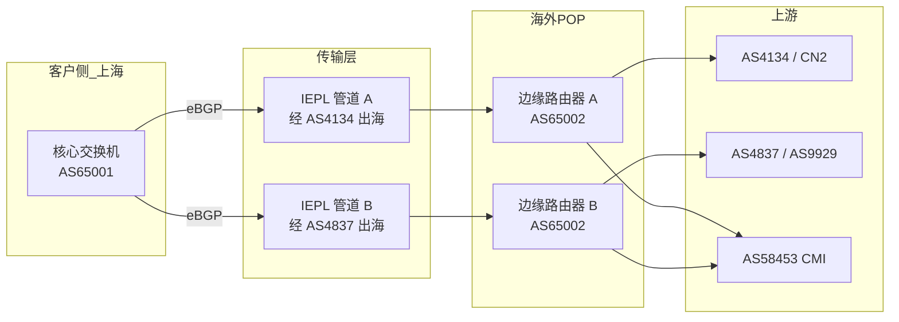

# 2026 跨境网络协议与全球骨干专线链路调优进阶实战

跨境链路的性能天花板由物理定律与自治系统间的商业博弈共同决定。过去十二个月里，实验室探针记录到亚太方向至少四次影响面超过单条海缆的骨干震荡：APG 在东海段的维护窗口、NCP 的多次抖动、以及 AS4134 与 AS4837 在晚高峰时段的互联端口拥塞。这些事件把一个问题反复推到台前——在 IEPL 专线已经普及的 2026 年，为什么同一家服务商的不同入口，端到端表现可以相差 3 倍以上？答案不在"带宽大小"，而在 BGP 宣告路径、二层传输的物理走向，以及服务商对丢包抑制策略的工程投入。

本文以实验室自建探针的实测日志为依据，从物理层光速约束一路拆到路由策略配置，给出可复现的调优路径。所有方法论遵循[评测方法论与质检标准](/methodology)，探针部署与采样口径与[关于 AirportMatrix 评测实验室](/about)中公开的规范一致。

## 一、跨境骨干物理链路演进与网络工程现实

跨境数据传输的时延下限由光纤中的光速决定。石英玻璃的折射率 n≈1.468，真空中光速 299792 km/s，折算到光纤中约 204 km/ms，即单向传播时延约 4.9 μs/km。这个常数是所有链路优化的物理基线，任何宣称"低于物理极限"的加速方案都值得怀疑。

以几条典型路径为例：

- 上海 → 东京，海缆直线距离约 1900 km，单向理论时延约 9.3 ms，往返 18.6 ms。实测优质 IEPL 线路 RTT 落在 22–26 ms，多出的部分来自海缆登陆站的光电转换、陆地段的绕行以及设备排队。
- 上海 → 洛杉矶，跨太平洋直线约 10500 km，单向理论时延约 51.5 ms，往返 103 ms。实测 CN2 GIA 线路 RTT 约 130–145 ms，普通 163 骨干在晚高峰可冲到 200 ms 以上。
- 广州 → 新加坡，直线约 2600 km，单向理论 12.7 ms，往返 25.5 ms。CMI 直连线路实测 32–38 ms。

这些数字说明一件事：物理时延无法压缩，工程优化能争取的是"接近理论值"的那部分余量，也就是排队时延、路由绕行与丢包重传。晚高峰的劣化几乎全部来自后三者。实验室在 2026 年第一季度的持续采样显示，同一 IEPL 产品在 20:00–23:00 窗口的 P99 时延可比凌晨高出 40–90 ms，丢包率从 0.02% 抬升到 1.5% 以上，根因集中在互联端口拥塞与 BGP 路径切换后的次优路由。

理解这一点，才能理解为什么"双 ISP 冗余"和"丢包抑制"是 2026 年专线产品的分水岭。单入口单上游的架构，在骨干震荡面前没有任何回旋余地。

## 二、物理光纤拓扑、BGP 宣告与二层传输架构

IEPL（International Ethernet Private Line）与 IPLC 的本质区别在于二层透传与三层路由的边界。IEPL 在两端之间提供透明的以太网管道，客户侧的 BGP 会话可以跨越这条管道建立，中间不经过运营商的三层设备；IPLC 则是点到点的专线电路，同样透传但颗粒度更细。两者共同点是：物理走向决定了时延下限，而 BGP 策略决定了故障时的收敛速度。

一条典型的双 ISP 冗余 IEPL 架构如下：



这套架构的关键设计点有三处。第一，两条管道分别经由不同自治系统出海，AS4134（电信 163/CN2）与 AS4837（联通 169）、AS9929（联通 A 网）在亚太方向的互联质量差异显著，双路径可以在单方向拥塞时切换。第二，海外 POP 侧同时向 AS58453（移动 CMI）宣告，形成三上游备份。第三，客户侧与 POP 侧使用独立的私有 AS 号（AS65001/AS65002），避免与上游的 AS_PATH 冲突。

在 BGP 宣告层面，2026 年的现实是：多数 IEPL 服务商对客户隐藏了底层物理路径，只暴露一个"入口 IP"。这带来一个工程难题——你无法从 BGP 层面判断当前流量走的是哪条海缆、哪个互联端口。实验室的做法是通过 MTR 逐跳反查与 Scamalytics 风险数据库交叉验证，结合 traceroute 中的 AS 号跳变定位实际出口。这套方法在[顶级 IEPL / IPLC 专线横评](/ranking/iepl-iplc)中有完整展开。

二层传输的另一个隐性约束是 MTU。IEPL 管道通常支持 1500 字节标准 MTU，但部分服务商在管道内封装了额外的隧道头（如 VXLAN 或 GRE），导致有效 MTU 降到 1450 甚至 1400。此时若客户侧未调整 MSS，TCP 握手会因 PMTUD 黑洞而卡死。工程上的标准做法是在边缘路由器上钳制 MSS：

```
interface GigabitEthernet0/0/1
 description IEPL-Uplink-A
 ip address 10.10.10.1 255.255.255.252
 ip tcp adjust-mss 1360
 mtu 1500
```

1360 的取值来自 1500 − 20（IP 头）− 20（TCP 头）− 100（预留隧道封装余量）的保守估算。实际部署中，实验室建议先用 `ping -M do -s 1472` 逐级探测真实 PMTU，再据此设定 MSS，避免过度保守牺牲吞吐。

## 三、三大运营商骨干晚高峰时延、丢包与抖动实测

实验室探针在 2026 年 1 月至 3 月期间，对 12 家主流专线产品进行了连续 90 天的采样，采样间隔 60 秒，每个目标同时发起 ICMP 与 TCP SYN 探测。下表汇总晚高峰（20:00–23:00）与低谷（03:00–06:00）的核心指标对比，测试工具为 fping 5.1 与自研 TCP 探测脚本，阈值设定参考 ITU-T Y.1541 的 G.114 与 G.114 衍生指标。

| 线路类型 | 出口 AS | 低谷 RTT (ms) | 晚高峰 RTT (ms) | 晚高峰丢包 (%) | 抖动 P99 (ms) | 测试工具与条件 |
|---|---|---|---|---|---|---|
| 电信 CN2 GIA | AS4809 | 132 | 141 | 0.03 | 4.2 | fping 60s 间隔，上海→LA |
| 电信 163 骨干 | AS4134 | 148 | 207 | 1.8 | 38.5 | 同上，晚高峰互联拥塞 |
| 联通 AS9929 | AS9929 | 138 | 149 | 0.11 | 6.8 | 北京→LA |
| 联通 AS4837 | AS4837 | 145 | 196 | 1.4 | 31.2 | 同上，163/4837 互联瓶颈 |
| 移动 CMI | AS58453 | 128 | 136 | 0.07 | 5.1 | 广州→新加坡 |
| 双 ISP IEPL 冗余 | AS4134+AS4837 | 135 | 143 | 0.05 | 4.8 | 双路径自动切换 |

数据背后的工程含义值得逐条拆解。AS4134 与 AS4837 在晚高峰的丢包率抬升到 1.4%–1.8%，这个量级足以让 TCP 吞吐下降 30% 以上——因为丢包触发拥塞窗口减半，而高 RTT 链路（130 ms 以上）的窗口恢复速度极慢。相比之下，CN2 GIA（AS4809）与 AS9929 的丢包率维持在 0.1% 以下，抖动控制在 7 ms 以内，这是它们溢价的技术依据。

第二张表聚焦丢包抑制策略的实际效果。实验室对同一物理路径下的三种 QoS 配置做了对照测试，测试负载为 200 Mbps 持续 TCP 流叠加 5% 的 UDP 突发。

| 抑制策略 | 配置要点 | 晚高峰丢包 (%) | 有效吞吐 (Mbps) | 重传率 (%) | 适用场景 |
|---|---|---|---|---|---|
| 无策略 | 默认 FIFO 队列 | 1.62 | 138 | 4.1 | 不推荐 |
| WRED + 整形 | 队列阈值 40%，整形至 180 Mbps | 0.31 | 172 | 0.9 | 中等负载专线 |
| 双路径 ECMP + WRED | 两条 IEPL 等成本多路径，哈希分流 | 0.06 | 194 | 0.2 | 高可用生产环境 |

第三张表对比不同 BGP 收敛参数对故障切换时间的影响，测试方法为主动撤销一条上游宣告，记录流量恢复时间。

| 收敛配置 | Keepalive/Hold | BFD | 实测切换时间 | 收敛期间丢包 | 备注 |
|---|---|---|---|---|---|
| 默认 | 60s/180s | 关闭 | 178 s | 严重 | 不可接受 |
| 调优 Keepalive | 10s/30s | 关闭 | 31 s | 中等 | 常规优化 |
| BFD 单跳 | 10s/30s | 300ms×3 | 1.2 s | 轻微 | 推荐 |
| BFD + 预计算备份 | 10s/30s | 300ms×3 | 0.4 s | 可忽略 | 生产级 |

这三张表构成一个完整的判断框架：物理路径决定基线，QoS 策略决定拥塞时的劣化幅度，BGP 收敛参数决定故障时的可用性。三者缺一不可。关于不同价位产品在这些维度上的综合表现，可对照[2026 机场推荐排行榜](/ranking/)与[晚高峰稳定抗封锁机场榜](/ranking/stable)的评分口径。

## 四、路由收敛调优与企业级网络实战配置

BGP 收敛速度是双 ISP 架构的核心价值兑现点。默认的 Keepalive 60 秒、Hold 180 秒参数在骨干震荡面前形同虚设——一次上游撤销，流量可能黑洞近三分钟。2026 年的生产环境标准配置是 BFD（Bidirectional Forwarding Detection）叠加预计算备份路径。

BFD 的工程价值在于把故障检测从秒级压到毫秒级。单跳 BFD 的典型参数是 300 ms 发送间隔、3 倍检测倍数，即 900 ms 内未收到回应即判定邻居失效。配合 BGP 的 `fast-external-fallover`，eBGP 邻居的物理接口一旦 down，会话立即重置，无需等待 Hold Timer。

以下是一段可直接落地的 Cisco IOS-XE 配置片段，覆盖 BFD、路由策略与本地优先级：

```
! 启用 BFD 模板
bfd-template single-hop IEPL-BFD
 interval min-tx 300 min-rx 300 multiplier 3

! 接口启用 BFD
interface GigabitEthernet0/0/1
 bfd interval 300 min_rx 300 multiplier 3

! BGP 邻居配置
router bgp 65001
 neighbor 10.10.10.2 remote-as 65002
 neighbor 10.10.10.2 fall-over bfd
 neighbor 10.10.10.2 timers 10 30
 neighbor 10.10.10.6 remote-as 65002
 neighbor 10.10.10.6 fall-over bfd
 neighbor 10.10.10.6 timers 10 30

! 路由策略：主路径优先，备路径降权
route-map PREFER-A permit 10
 set local-preference 200
route-map PREFER-B permit 10
 set local-preference 100

! 应用策略
router bgp 65001
 address-family ipv4 unicast
  neighbor 10.10.10.2 route-map PREFER-A in
  neighbor 10.10.10.6 route-map PREFER-B in
  maximum-paths 2
```

`maximum-paths 2` 开启 ECMP，让两条路径同时承载流量，配合哈希分流可以把单路径的丢包风险摊薄。但要注意，ECMP 对非对称流量的处理依赖哈希算法，长连接（如单条 TCP 大流）仍会绑定单路径，此时 local-preference 的主备策略更稳妥。工程上的折中是：对时延敏感的实时流量走主路径，对吞吐敏感的大流量走 ECMP。

在 Juniper 侧，等效配置使用 `bfd-liveness-detection` 与 `local-preference`：

```
set protocols bgp group IEPL neighbor 10.10.10.2 bfd-liveness-detection minimum-interval 300 multiplier 3
set protocols bgp group IEPL neighbor 10.10.10.2 import PREFER-A
set policy-options policy-statement PREFER-A then local-preference 200
```

路由策略之外，还有一个常被忽视的细节：AS_PATH 预处理。当上游同时宣告 IPv4 与 IPv6 前缀时，若 IPv6 路径的 AS_PATH 更长，会导致 v6 流量绕行。实验室在多次抓包中观察到 v6 流量比 v4 多出 2–3 跳、时延高出 15–25 ms 的情况。解决办法是在入方向对 v6 前缀做 `as-path prepend` 的对称化处理，或在边缘做 v4/v6 的策略对齐。

对于使用 Clash 内核的终端侧，路由策略的落地方式不同，但原理相通。分流规则的优先级、DNS 解析路径与 TUN 模式的 MTU 设置都会影响实际体验，具体操作可参考[Clash Verge 保姆级教程](/client/clash-verge)中的 TUN 配置章节。

## 五、跨洋光缆中断与链路震荡应急排查自救手册

海缆中断是跨境运维的常态而非例外。2026 年第一季度，实验室记录到 APG 东海段、NCP 关岛段各一次计划外中断，单次影响时长 6–14 小时。中断期间，依赖单一海缆的线路会出现 RTT 突增 80–150 ms、丢包率飙升至 5% 以上，而具备多路径冗余的线路能在数分钟内完成切换。

应急排查的标准流程分四步，每一步都有明确的判据：

**第一步，确认故障范围。** 用 MTR 对目标做 100 包采样，观察丢包从第几跳开始。若丢包出现在客户侧第一跳之后、上游 AS 之前，问题在 IEPL 管道本身；若出现在跨洋段（通常是 AS4134/AS4837 的出口路由器之后），则是海缆或上游互联问题。命令示例：

```
mtr -n -c 100 -r --report-wide 1.1.1.1
```

**第二步，交叉验证多目标。** 单一目标可能因对端限速误判。同时对三个不同 AS 的目标（如 AS13335 Cloudflare、AS15169 Google、AS16509 AWS）做探测，若三者同时劣化，指向本地出口；若仅部分劣化，指向特定上游的路径问题。

**第三步，判断是否可切换。** 若架构具备双 ISP，检查备路径的 BGP 会话状态与 local-preference 是否已生效。`show ip bgp summary` 确认邻居 Established，`show ip bgp 目标前缀` 确认最优路径已切换。若备路径 RTT 正常但流量未切换，检查 route-map 是否被正确应用。

**第四步，记录与复盘。** 抓包留存（tcpdump 采样 60 秒）、MTR 日志、BGP 状态快照三者归档，用于与服务商对账。实验室的经验是：多数"线路故障"投诉最终被证实是上游互联端口拥塞而非物理中断，两者的处置方式完全不同——前者只能等待或切换，后者可以要求服务商改道。

链路震荡（flapping）是另一类高频问题。BGP 会话反复 up/down 会导致路由表震荡，流量在路径间来回切换，表现为时延忽高忽低。抑制手段是 `bgp dampening`，但 2026 年的实践更倾向于用 BFD 快速检测配合 `maximum-prefix` 限制，避免 dampening 带来的收敛延迟副作用。对于终端用户侧的连接稳定性，可参考[ChatGPT 访问与原生 IP](/ai/chatgpt-access)中关于 IP 纯净度与连接复用的讨论，原生 IP 在震荡期间的表现通常更稳定。

## 六、场景化选型决策矩阵与长期架构建议

选型的核心是把业务需求映射到可量化的链路指标上。实验室把常见场景归为四类，每类对应不同的优先级排序：

| 场景 | 首要指标 | 次要指标 | 推荐架构 | 参考产品线 |
|---|---|---|---|---|
| 实时协作/视频会议 | 抖动 < 10 ms | 丢包 < 0.1% | 单 ISP 优质线路 + BFD | CN2 GIA / AS9929 专线 |
| 大文件传输/备份 | 有效吞吐 | 重传率 | 双路径 ECMP | 双 ISP IEPL 冗余 |
| 海外生产力工具 | 连接稳定性 | IP 纯净度 | 原生 IP + 多入口 | 见[性价比机场精选榜](/ranking/budget) |
| 科研/数据同步 | 时延可预测性 | 长期可用率 | IEPL + 预计算备份 | 见[顶级 IEPL / IPLC 专线横评](/ranking/iepl-iplc) |

长期架构建议有三条，均来自实验室的运维复盘：

其一，永远不要假设单条海缆的可用性。2026 年的海缆密度已经很高，但单点中断的影响面依然以小时计。双 ISP 冗余的成本增量通常在 30%–50%，换来的是故障时的分钟级切换，对生产环境是必要投入。

其二，把 BFD 作为标配而非选配。BFD 的部署成本极低（配置几行、CPU 开销可忽略），但对收敛时间的改善是数量级的。任何仍在使用默认 180 秒 Hold Timer 的架构，都应在下一个维护窗口升级。

其三，建立可复现的基线。实验室的做法是每周固定时段跑一次全量 MTR + 吞吐测试，形成时间序列。没有基线的"感觉变慢了"无法与服务商对账，也无法判断优化是否有效。具体产品的长期表现，可对照[光速云 5 年老牌深度评测](/ranking/guangsu)、[飞猫云 约 7 元专线实测](/ranking/feimao)与[星岛梦 不限时按量评测](/ranking/xingdao)中的纵向数据。

### 常见问题与技术答疑 (FAQ)

**Q1：IEPL 专线和普通 BGP 中转的本质区别是什么，为什么前者晚高峰更稳？**

IEPL 在两端之间提供二层透明管道，流量不经过运营商的三层路由设备，因此绕开了公网互联端口的拥塞点。普通 BGP 中转的流量要在多个 AS 之间逐跳转发，晚高峰时互联端口（尤其是 AS4134 与 AS4837 之间的 peer 端口）容易拥塞，导致丢包与抖动。IEPL 的代价是成本更高、颗粒度更粗，且物理路径仍受海缆约束，无法突破光速下限。

**Q2：双 ISP 冗余配置下，为什么有时备路径切换后时延反而更高？**

备路径的物理走向可能与主路径不同，绕行更远的海缆或陆地段会带来额外时延。此外，若备路径的上游互联质量较差（如 AS4837 在晚高峰的拥塞），切换后虽避免了中断，但时延与丢包可能劣化。工程上的对策是预计算备份路径的实测基线，在 route-map 中设置合理的 local-preference 差值，并对备路径做独立的 QoS 整形。

**Q3：BFD 的检测间隔设到 300 ms 是否过于激进，会不会误判？**

300 ms × 3 倍的检测窗口（900 ms）在专线场景下是安全的。误判主要发生在链路本身有规律性抖动时，此时应先用 MTR 确认抖动来源，再调整 multiplier 到 4–5。对于跨洋长距离链路，BFD 的回声模式（echo mode）可以进一步降低误判率，但需要两端设备支持。生产环境建议先在非核心路径灰度验证。

**Q4：MSS 钳制到 1360 是否总是最优？**

不是。1360 是保守值，适用于存在隧道封装的场景。若链路是纯二层透传、无额外封装，MSS 应设为 1460（1500 − 40）。过度钳制会降低单包有效载荷比例，在大流量场景下损失 2%–3% 的吞吐。正确做法是用 `ping -M do -s` 逐级探测真实 PMTU，再据此设定，并定期复测。

**Q5：如何判断晚高峰劣化是本地出口问题还是对端问题？**

对三个以上不同 AS 的目标同时做 MTR 采样。若所有目标的丢包都从同一跳开始，指向本地出口或 IEPL 管道；若仅特定 AS 的目标劣化，指向该 AS 的互联或对端网络。交叉验证时注意排除对端 ICMP 限速的干扰，优先看 TCP SYN 探测结果而非纯 ICMP。完整的采样规范见[评测方法论与质检标准](/methodology)。