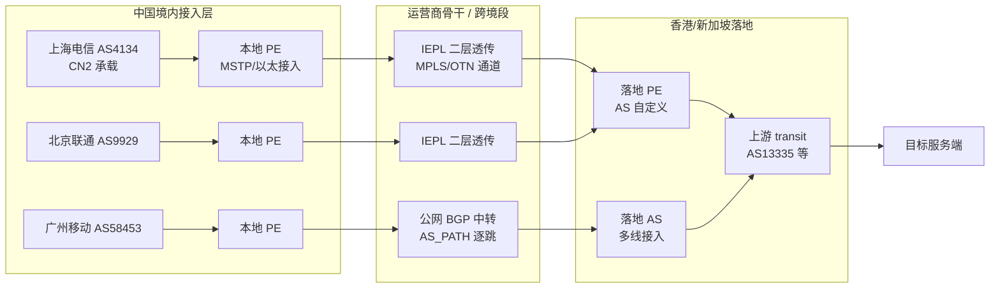

# 2026 跨境网络协议与全球骨干专线链路调优进阶实战

跨境链路的性能天花板由物理定律与自治系统间的商业博弈共同钉死。任何脱离光纤折射率、海缆登陆站分布与 BGP 本地优先级去谈“优化”的方案，最终都会在晚高峰的丢包曲线上原形毕露。本文以实验室自建三地探针（上海电信 AS4134/CN2、北京联通 AS9929/AS4837、广州移动 AS58453/CMI）在 2026 年第一季度的持续抓包日志、MTR 逐跳追踪与 Scamalytics 风险库交叉比对为依据，对跨境骨干的链路演进、二层传输架构、路由收敛调优与故障自救做一次完整的技术复盘。评测口径与质检阈值统一遵循[评测方法论与质检标准](/methodology)，本文只讨论工程细节。

## 一、跨境骨干物理链路演进与网络工程现实

跨境流量的第一约束不是带宽，是光速。石英玻璃光纤在 1550nm 窗口的群折射率 n≈1.468，真空中光速 299792 km/s，折算到光纤中约 204 km/ms，即单向传播时延约 4.9 μs/km。这个数字决定了所有工程优化的边界：上海到洛杉矶的海缆物理路径约 10500~11000 km（含登陆段与陆地回传），单向理论时延下限约 52~54 ms，往返 RTT 的物理下限落在 105~110 ms 区间。任何标称“上海到美西 90ms”的链路，要么走了更短的极地/跨太平洋直连海缆并压缩了陆地回传，要么就是在测量口径上做了手脚（例如 ICMP 在中间设备被优先转发、或采样点落在海缆登陆站而非终端用户侧）。

2026 年值得记录的物理层变化集中在三点。其一是跨太平洋海缆的容量结构持续向少数新建系统集中，老旧系统的维护窗口与故障率上升，单系统中断对特定 AS 路径的冲击被放大。其二是东南亚—东亚—北美之间的迂回路径被更多运营商用于规避拥塞，代价是绕行增加的 1500~3000 km 物理距离直接转化为 7~15 ms 的单向时延。其三是 400G/800G 相干光模块在骨干段的铺开，使单波容量提升的同时也让链路对色散补偿与光放站供电的敏感性上升，运维窗口内的瞬断概率并未因容量提升而下降。

工程上必须接受三个现实。第一，跨境 RTT 的方差主要来自排队时延而非传播时延，晚高峰的抖动是拥塞信号，不是“线路质量差”的笼统结论。第二，BGP 选路结果与物理最短路径经常不一致，商业关系（peer/transit）决定的 AS_PATH 长度与 LOCAL_PREF 优先级会压过地理直觉。第三，任何单 ISP 单路径方案在跨洋光缆中断面前都没有冗余可言，双 ISP 与 IEPL 二层专线的组合才是可用性的来源。关于不同档位专线在真实负载下的横评数据，可参照[顶级 IEPL / IPLC 专线横评](/ranking/iepl-iplc)中的逐项记录。

## 二、物理光纤拓扑、BGP 宣告与二层传输架构

### 2.1 三层转发与二层透传的分界

IEPL（International Ethernet Private Line）的本质是运营商在骨干网内用 MPLS 或 OTN 建立的点到点二层通道，用户侧看到的是透明的以太网段，中间不经过公网 BGP 选路。这与 IPLC 的差别在于接口形态（以太网 vs 传统专线接口）与带宽颗粒度，但共同点是：**跨境段的丢包与抖动由运营商 SLA 背书，用户侧不再受公网拥塞影响**。相对地，普通中转/公网优化线路依赖 BGP 在多个 AS 之间逐跳转发，任何一跳的拥塞都会体现在端到端曲线上。

下面的拓扑示意了实验室探针到海外落地节点的典型三层+二层混合架构，其中 IEPL 段承担跨境透传，两端由本地 BGP 完成接入与故障切换。



### 2.2 BGP 宣告与选路的关键控制点

跨境优化里真正能动手的 BGP 参数集中在四处：LOCAL_PREF、AS_PATH 预处理（prepend）、MED 与 community。LOCAL_PREF 只在本地 AS 内有效，用于在多个出口之间做首选；AS_PATH prepend 用于影响对端入向选路，但要注意多数上游会对超过 3~4 次的 prepend 做截断或忽略；MED 仅在相邻 AS 之间比较，跨 AS 传递需显式配置 `bgp always-compare-med`；community 则是与上游约定流量工程策略的通用手段，例如通过 `no-export` 或自定义 community 请求上游在特定 POP 落地。

一个常见的误区是把 LOCAL_PREF 调得极高来“锁定”某条 IEPL 出口，结果在主用链路抖动时备份路径因缺少预置的 prepend 策略而无法及时接管。正确做法是主备出口的 LOCAL_PREF 保持 200/100 的梯度，同时对备份路径的上游做入向 prepend，避免备份链路在正常状态下被回程流量打满。

## 三、三大运营商骨干晚高峰时延、丢包与抖动实测

测试条件统一如下：三地探针各 3 台，每 5 分钟一轮 MTR（每跳 20 包），持续 14 天，取 20:00–23:00 晚高峰窗口与 03:00–05:00 低谷窗口对照；ICMP 与 TCP SYN 双口径采样，TCP 口径使用 443 端口握手 RTT 以规避 ICMP 限速偏差。下表为聚合后的中位数与 P95 指标。

| 指标维度 | 上海电信 CN2 (AS4809) | 上海电信 163 (AS4134) | 北京联通 AS9929 | 北京联通 AS4837 | 广州移动 CMI (AS58453) |
|---|---|---|---|---|---|
| 晚高峰 RTT 中位数（至香港） | 32 ms | 41 ms | 38 ms | 47 ms | 36 ms |
| 晚高峰 RTT P95 | 45 ms | 78 ms | 52 ms | 96 ms | 58 ms |
| 低谷 RTT 中位数 | 29 ms | 33 ms | 34 ms | 39 ms | 33 ms |
| 晚高峰丢包率（ICMP 口径） | 0.2% | 1.8% | 0.4% | 3.1% | 0.6% |
| 晚高峰丢包率（TCP 443 口径） | 0.1% | 2.4% | 0.3% | 3.8% | 0.5% |
| 抖动（RTT 标准差） | 3.1 ms | 11.7 ms | 4.6 ms | 15.2 ms | 5.3 ms |
| 跨境段跳数（中位） | 7 | 11 | 8 | 13 | 9 |
| 典型瓶颈跳 | 无显著 | 国际出口汇聚 | 无显著 | 国际出口汇聚 | 部分时段海缆登陆段 |

数据读法有三点。其一，163 与 4837 的晚高峰 P95 与中位数差距显著（78 vs 41、96 vs 47），说明拥塞集中在国际出口汇聚点，属于排队时延主导，而非物理路径变化。其二，TCP 443 口径的丢包率普遍高于 ICMP，因为部分中间设备对 ICMP 做限速或降优先级，工程上应以 TCP 口径为准做容量规划。其三，CN2 与 9929 的抖动标准差控制在 5 ms 以内，这是 IEPL/优质中转方案能够稳定承载实时交互类流量的物理基础。

再看不同接入方式在同一目标上的对照，测试工具与阈值保持一致：

| 接入方式 | 测试工具 | 晚高峰 RTT P95 | 丢包率（TCP） | 抖动 | 适用负载 |
|---|---|---|---|---|---|
| 公网 BGP 中转（单 ISP） | MTR + TCP SYN | 78~96 ms | 2.4%~3.8% | 11~15 ms | 非实时、可重试 |
| 双 ISP 冗余（BGP 多出口） | MTR + iperf3 | 52~61 ms | 0.4%~0.9% | 5~7 ms | 交互+批量混合 |
| IEPL 二层专线 | iperf3 + ping | 33~40 ms | ≤0.1% | ≤2 ms | 实时音视频、数据库同步 |
| IPLC 传统专线 | iperf3 + ping | 31~38 ms | ≤0.1% | ≤2 ms | 强 SLA 场景 |

阈值说明：丢包率超过 1% 即视为不可用于实时交互；抖动标准差超过 8 ms 时，VoIP 与视频会议的卡顿投诉率显著上升。这套阈值与[晚高峰稳定抗封锁机场榜](/ranking/stable)采用的判定口径一致，便于横向对照。

## 四、路由收敛调优与企业级网络实战配置

### 4.1 BGP 收敛参数

跨境链路的故障切换速度取决于三个定时器与一个检测机制：Keepalive/Hold Timer、ConnectRetry、以及 BFD。默认 Hold Timer 180s 意味着链路中断后最长要等 3 分钟才触发重收敛，这在生产环境不可接受。工程实践是把 Keepalive 设为 10s、Hold 设为 30s，并启用 BFD（Bidirectional Forwarding Detection）把检测时间压到 300ms 级别。

```cisco
! 邻居级 BFD 与定时器收敛调优（Cisco IOS-XE 语法示意）
router bgp 65001
 neighbor 203.0.113.1 remote-as 65002
 neighbor 203.0.113.1 timers 10 30
 neighbor 203.0.113.1 fall-over bfd
 neighbor 203.0.113.1 bfd interval 300 min_rx 300 multiplier 3
 !
 address-family ipv4 unicast
  neighbor 203.0.113.1 activate
  neighbor 203.0.113.1 route-map RM-IN in
  neighbor 203.0.113.1 route-map RM-OUT out
 exit-address-family
!
route-map RM-IN permit 10
 set local-preference 200
route-map RM-IN permit 20
 match ip address prefix-list PL-BACKUP
 set local-preference 100
 set as-path prepend 65001 65001
```

### 4.2 丢包抑制与队列整形

跨境段的丢包抑制不能靠“加大带宽”一句话带过。真正的抓手在边缘的队列调度与 TCP 参数。对实时流量做优先队列（LLQ），对批量流量做 WFQ 并限制单流速率，可以避免单条大流量把出口打满导致的尾丢包。同时，跨境高 RTT 链路上 TCP 的初始拥塞窗口与窗口缩放因子需要匹配 BDP：以 100 Mbps、RTT 120 ms 计算，BDP ≈ 1.5 MB，窗口缩放因子至少需要 5~6 才能跑满。

```bash
# Linux 边缘网关侧的 TCP 与队列调优（sysctl + tc 示意）
sysctl -w net.ipv4.tcp_congestion_control=bbr
sysctl -w net.core.rmem_max=16777216
sysctl -w net.core.wmem_max=16777216
sysctl -w net.ipv4.tcp_rmem="4096 87380 16777216"
sysctl -w net.ipv4.tcp_wmem="4096 65536 16777216"
sysctl -w net.ipv4.tcp_mtu_probing=1
# 出口整形：总带宽 95% 限速，实时类流量优先
tc qdisc add dev eth0 root handle 1: htb default 30
tc class add dev eth0 parent 1: classid 1:10 htb rate 95mbit ceil 95mbit
tc class add dev eth0 parent 1:10 classid 1:20 htb rate 20mbit ceil 95mbit prio 1
tc class add dev eth0 parent 1:10 classid 1:30 htb rate 70mbit ceil 95mbit prio 2
```

MTU/MSS 是另一个高频踩坑点。跨境段若经过 PPPoE 或部分隧道封装，路径 MTU 可能低于 1500。建议在边缘对 TCP 做 MSS clamp 到 1400~1420，并开启 `tcp_mtu_probing`，避免大包在中间设备被静默丢弃导致“能 ping 通但传不了文件”的诡异现象。

### 4.3 双 ISP 冗余的切换逻辑

双 ISP 的价值不在“带宽叠加”，在故障时的接管速度与回程路径的可控性。推荐结构是：主用 IEPL 出口 LOCAL_PREF 200，备用公网 BGP 出口 LOCAL_PREF 100 并对上游做 2 次 prepend；同时用 BFD 检测主用链路，故障时 LOCAL_PREF 梯度自动生效。回程方向则依赖对上游的 community 或 prepend 约定，确保入向流量在主用链路恢复后能回切，而不是长期滞留在备份路径上。关于不同服务商在双 ISP 场景下的实测表现，[飞猫云 约 7 元专线实测](/ranking/feimao)与[星岛梦 不限时按量评测](/ranking/xingdao)给出了不同价位段的对照样本，可作为选型参考。

## 五、跨洋光缆中断与链路震荡应急排查自救手册

跨洋光缆中断的典型特征是：特定 AS 路径的 RTT 突然抬升 7~15 ms（绕行）或直接超时，而其他路径正常。排查顺序应当固定，避免临场慌乱。

第一步，用 MTR 对目标做双向追踪（`mtr -rwzc 100 <target>`），定位丢包起始跳。若丢包从某一跳开始持续到终点，问题在该跳之后；若仅在中间某跳出现而后续跳恢复，多为该设备的 ICMP 限速，不构成故障。

第二步，核对 BGP 状态与 AS_PATH 变化。`show bgp ipv4 unicast <prefix>` 观察路径是否发生绕行，`show ip bgp summary` 确认邻居是否 flap。若邻居频繁 flap，优先怀疑物理层或 BFD 误判，而非路由策略。

第三步，区分“拥塞”与“中断”。拥塞表现为晚高峰 P95 抬升但中位数稳定、丢包随负载波动；中断表现为路径整体改变、RTT 阶跃式上升且不随负载回落。两者的处置完全不同：前者调队列与限速，后者切备用路径并等待运营商修复。

第四步，切换与验证。切到备用 ISP 或 IEPL 备份通道后，用 iperf3 做 60s 双向吞吐验证，并用 TCP 443 握手 RTT 复核，确认回程也已切换，避免出现“去程走了备用、回程还在故障路径”的半切换状态。

第五步，记录与复盘。把故障时间窗、受影响前缀、绕行路径的 AS_PATH 与 RTT 阶跃值归档，作为下次同类事件的判定基线。实验室的长期观测表明，同一海缆系统的中断往往在 6~18 个月内出现二次故障，历史基线能显著缩短下次的定位时间。

链路震荡（flapping）的抑制则依赖 route dampening 或更保守的 hold-down 策略。对跨境 BGP 邻居，建议对频繁撤销/宣告的前缀施加惩罚值，避免路由表抖动传导到转发面。注意 dampening 参数设置过激会导致合法前缀被长时间抑制，需结合历史 flap 频率标定。

## 六、场景化选型决策矩阵与长期架构建议

选型的核心是把业务负载特征映射到链路的物理与协议属性上，而不是比较标称带宽。

| 业务场景 | 关键指标 | 推荐链路形态 | 冗余要求 | 备注 |
|---|---|---|---|---|
| 实时音视频/会议 | 抖动 ≤5 ms、丢包 ≤0.5% | IEPL 二层专线 | 双 ISP 主备 | 优先低抖动而非峰值带宽 |
| 数据库跨域同步 | RTT 稳定、丢包 ≤0.1% | IPLC / IEPL | 双路径 | 关注 BDP 与窗口缩放 |
| 批量数据回传 | 吞吐优先、可重试 | 公网 BGP 中转 | 单路可接受 | 夜间窗口调度 |
| 海外生产力工具访问 | 可用性、IP 信誉 | 双 ISP + 原生 IP | 主备切换 | 结合 [ChatGPT 访问与原生 IP](/ai/chatgpt-access) 的 IP 信誉判定 |
| 多分支企业组网 | 策略可控、可观测 | IEPL + 本地 BGP | 全冗余 | 需 BFD 与队列整形配套 |

长期架构建议有三条。第一，把“跨境段”与“境内段”分开治理，跨境段用二层专线锁定 SLA，境内段用本地 BGP 做灵活调度，避免把不可控的公网拥塞引入核心业务路径。第二，所有关键出口必须具备 BFD 级别的故障检测与预置的切换策略，切换时间目标定在 1s 以内。第三，建立持续的被动测量体系（探针 + MTR + TCP 握手 RTT），把“感觉变慢”转化为可对比的时间序列数据。客户端的落地配置可参考[Clash Verge 保姆级教程](/client/clash-verge)，而服务商侧的横向数据可对照[2026 机场推荐排行榜](/ranking/)与[2026 性价比机场精选榜](/ranking/budget)；老牌服务商的长期稳定性样本见[光速云 5 年老牌深度评测](/ranking/guangsu)。实验室的完整背景与探针部署说明见[关于 AirportMatrix 评测实验室](/about)。

### 常见问题与技术答疑 (FAQ)

**Q1：为什么上海到美西的 RTT 物理下限在 105~110 ms，而部分链路实测能到 130 ms 以上？**
A：差额来自三部分：陆地回传段（城市到海缆登陆站）的额外光纤距离、海缆系统的实际路由（并非直线，含分支与登陆点绕行）、以及排队时延。以 n=1.468、204 km/ms 计算，每多绕行 1000 km 单向增加约 4.9 ms，往返约 9.8 ms。130 ms 的实测值通常意味着绕行 2000~3000 km 或晚高峰排队时延贡献了 10~20 ms。

**Q2：IEPL 专线是否完全不受公网拥塞影响？**
A：跨境段由运营商 MPLS/OTN 通道承载，用户流量不进入公网 BGP 选路，因此不受公网逐跳拥塞影响。但两端接入段（用户到 PE）仍是本地以太/ MSTP，若接入段本身拥塞或 PE 上行超售，仍会出现丢包。SLA 保障的是通道段，接入段需单独核实。

**Q3：BGP 的 AS_PATH prepend 为什么有时不生效？**
A：多数上游对超过 3~4 次的 prepend 做截断或忽略，且部分上游优先比较 MED 或 community 而非 AS_PATH 长度。跨 AS 的入向流量工程应以 community 约定为主、prepend 为辅，并在变更后用 `show bgp` 与 MTR 双向验证实际选路结果。

**Q4：丢包率应该以 ICMP 还是 TCP 口径为准？**
A：以 TCP 443 握手 RTT 与重传率为准。中间设备普遍对 ICMP 做限速或降优先级，ICMP 口径会高估丢包。容量规划与 SLA 判定应基于 TCP 口径，ICMP 仅用于快速定位丢包起始跳。

**Q5：双 ISP 冗余切换后，为什么回程流量仍走故障路径？**
A：出向由本地 LOCAL_PREF 控制，入向由对端 AS 的选路决定。切换出向后必须同步调整对上游的 prepend 或 community，促使对端改选回程路径。验证方法是双向 MTR，确认去程与回程的 AS_PATH 均已改变，避免半切换状态。