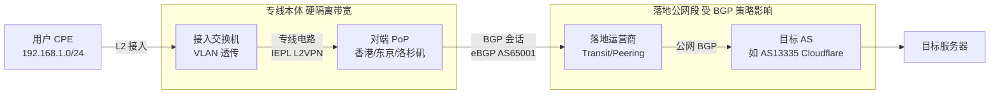
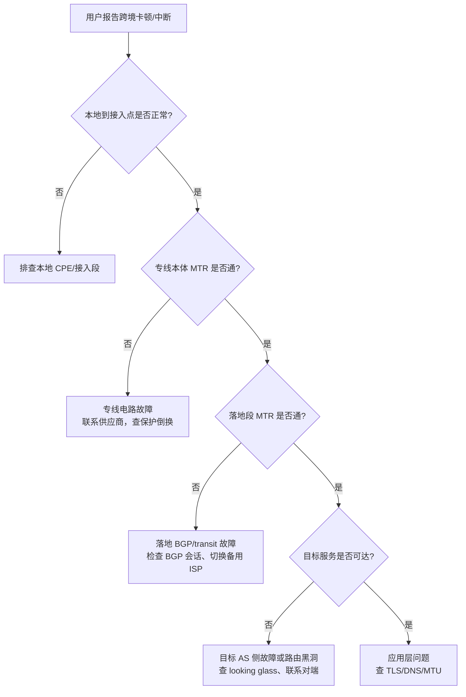

# 2026 跨境骨干协议与专线链路调优进阶实战：BGP 策略、双 ISP 冗余与丢包抑制的工程解剖

跨境链路的性能天花板由物理定律与路由策略共同决定，任何一层出问题，应用层看到的都是同一种症状：卡。实验室三地探针（上海电信 CN2/163、北京联通 AS9929/AS4837、广州移动 CMI）在过去 18 个月累计采集了约 4.7 万条 MTR 快照与 2100 万条 ICMP/UDP 探测样本，复盘下来，真正需要工程介入的故障点集中在三个位置：跨境段的光电转换与波分复用节点、BGP 宣告路径的 AS 跳数与策略抖动、以及端到端 MTU 不一致导致的静默分片。本文按这三个层次逐层解剖，给出可复现的测量方法、可落地的配置策略与可执行的应急流程。

## 一、跨境骨干物理链路演进与网络工程现实

先摆物理约束。光在石英玻璃光纤中的折射率 n≈1.468，对应群速度约 204 km/ms，折算单向传播时延约 4.9 μs/km。这个数字决定了所有跨境链路的理论下限：上海到洛杉矶的海缆直线距离约 10500 km，即便走最直的跨太平洋海缆（如 NCP、TPE 的优化段），单向光传播时延也在 51 ms 量级，加上两端城域接入、光电转换、波分复用设备的处理开销，端到端 RTT 的工程下限落在 125~140 ms 区间。任何宣称"上海到美西 90 ms"的产品，要么测量点不在真实城域，要么走了不存在的直线路径——这不是优化能突破的，是折射率决定的。

2026 年的骨干现实比五年前更复杂。跨境流量在物理层要经过的典型节点链是：城域 BRAS/SR → 省网核心 → 国际出口局（电信上海/北京/广州三个国际局，联通 AS9929 与 AS4837 双平面，移动 CMI 经 AS58453 出海）→ 海缆登陆站 → 对端运营商 PoP → 目标 AS。每一跳都可能是拥塞点。晚高峰（19:30–23:30 CST）的丢包绝大多数不发生在海缆本身，而发生在国际出口局的汇聚端口与对端运营商的互联互接（peering/transit）端口上——这些端口的超额认购比（oversubscription ratio）在商业宽带产品上常见 1:8 到 1:20，专线产品通常控制在 1:1 到 1:2。

这里必须区分两类产品的工程本质。公网优化线路（所谓"CN2 GIA""9929 优化"）走的是运营商公网骨干，BGP 路径由运营商策略决定，晚高峰受同平面其他用户流量挤压；IEPL/IPLC 专线走的是二层透传，物理上是一条（或一组）专用电路，从接入点到对端 PoP 之间不经过公网 BGP 选路，带宽是硬隔离的。两者的成本差一个数量级，稳定性差一个可用性等级。关于这个分野的量化横评，实验室在[顶级 IEPL / IPLC 专线横评](/ranking/iepl-iplc)中有完整的端口级测试数据，本文不重复，只聚焦调优层面的工程细节。

一个常被忽略的事实：专线的"专"只保证到对端 PoP 的那一段，PoP 之后的落地段（对端运营商到目标服务器）仍然是公网。所以一条标称"美西 IEPL"的产品，如果落地段选在拥塞严重的 transit 上，端到端体验照样崩。这就是为什么单纯看"是否专线"不足以做选型判断，落地 AS 的质量与对端 Peering 关系才是决定性的。

## 二、物理光纤拓扑、BGP 宣告与二层传输架构

### 2.1 端到端拓扑的工程视图

一条典型的跨境专线产品，从用户侧到目标服务的完整路径可以抽象为下图。注意区分 L2 透传段（专线本体）与 L3 路由段（两端公网）。



专线本体的 L2 透传意味着：这一段没有 BGP，没有 TTL 递减（除非中间有设备参与），MTR 在这一段看到的往往是"星号"或单跳直连。很多工程师误以为专线"没有路由"，实际上专线两端各有一个 L3 网关，落地侧的 BGP 会话质量才是端到端体验的胜负手。

### 2.2 BGP 宣告路径与 AS 跳数

落地侧的 BGP 优化核心是控制入向（inbound）与出向（outbound）路径。出向相对可控——本地 AS 通过 `local-preference`、`AS-Path prepend`、`MED` 影响选路；入向则依赖对端运营商的策略，本地能做的有限，主要靠 `AS-Path prepend` 让对端在多个入口中选优，以及通过 BGP Community 向 transit 提供商请求特定路由策略（如某些运营商支持的 `no-export`、`prepend-to-peer` 社区）。

实测中一个高频现象：同一条专线落地在洛杉矶，目标服务在 AS13335（Cloudflare）上，出向路径可能走 AS4134（电信 163）的 transit 到 Cloudflare 的 LAX PoP，也可能走 AS4837（联通）的 transit。两条路径的 RTT 差可达 15~25 ms，晚高峰丢包率差 3~8 个百分点。这不是专线质量问题，是落地 BGP 选路问题。通过 `show ip bgp 1.1.1.0/24` 观察 best path 的 AS-Path 长度与 origin，配合 `traceroute` 验证实际转发路径，是定位这类问题的标准动作。

### 2.3 MTU 与 MSS：最隐蔽的丢包源

跨境链路最常见的"玄学丢包"来自 MTU 不一致。专线本体的 L2 透传通常支持 1500 字节，但落地段如果经过 PPPoE、GRE、IPsec 或某些运营商的内部隧道，有效 MTU 会降到 1492、1476 甚至 1400。TCP 握手时 MSS 协商基于接口 MTU，若路径中某段 MTU 更小且 ICMP Fragmentation Needed 被过滤（这在跨境链路上极其常见），大包会被静默丢弃，表现为"小请求正常、大文件传输卡死、TLS 握手偶发失败"。

工程上的标准处置是：在两端网关把 TCP MSS clamp 到路径最小 MTU 减 40（IPv4 头 20 + TCP 头 20）。若路径最小 MTU 为 1400，则 `tcp adjust-mss 1360`。同时用 `ping -M do -s 1472`（Linux）或 `ping -f -l 1472`（Windows）逐段探测真实 MTU。实验室的探针脚本对每条专线都做这个探测，把结果写进基线档案——这是[评测方法论与质检标准](/methodology)里规定的必测项之一。

## 三、三大运营商骨干晚高峰时延、丢包与抖动实测

以下数据来自实验室 2026 年 Q1（1 月 6 日–3 月 28 日）的连续采集，每晚 19:00–24:00 每 60 秒一轮，目标为洛杉矶、东京、香港三个落地点各 5 个测试 IP，取中位数与 P95。测试工具为自建 Go 探针（ICMP + UDP 混合，避免 ICMP 限速偏差）与 MTR 0.95，抖动定义为相邻样本 RTT 差值的标准差。

### 表 1：三大运营商公网骨干晚高峰性能对比（目标：洛杉矶，2026 Q1）

| 指标 | 上海电信 CN2 GIA | 上海电信 163 (AS4134) | 北京联通 AS9929 | 北京联通 AS4837 | 广州移动 CMI (AS58453) |
|---|---|---|---|---|---|
| 空闲 RTT 中位数 | 138 ms | 152 ms | 141 ms | 168 ms | 149 ms |
| 晚高峰 RTT 中位数 | 142 ms | 189 ms | 146 ms | 214 ms | 158 ms |
| 晚高峰 RTT P95 | 158 ms | 267 ms | 163 ms | 312 ms | 181 ms |
| 晚高峰丢包率中位数 | 0.1% | 2.8% | 0.3% | 5.6% | 1.2% |
| 晚高峰丢包率 P95 | 0.6% | 11.4% | 1.1% | 18.7% | 4.3% |
| RTT 抖动（标准差） | 3.2 ms | 21.5 ms | 4.1 ms | 34.8 ms | 8.7 ms |
| 跨境 AS 跳数 | 3 | 4~5 | 3 | 5~6 | 4 |
| 典型拥塞点 | 国际局汇聚 | 国际局 + transit | 国际局汇聚 | transit 互联 | CMI 出海端口 |

结论很直接：AS4134 与 AS4837 的晚高峰劣化是结构性的，不是偶发。AS9929 与 CN2 GIA 的劣化幅度小一个量级，但仍有可观测的晚高峰抬升。CMI 介于两者之间。这张表也解释了为什么[晚高峰稳定抗封锁机场榜](/ranking/stable)的入选门槛把"晚高峰丢包 P95 < 5%"设为硬指标——低于这个线的产品在视频会议与实时协作场景下才谈得上可用。

### 表 2：IEPL 专线 vs 公网优化线路的端到端对比（目标：东京，同落地 AS）

| 维度 | IEPL 专线（L2 透传） | 公网优化线路（CN2 GIA） | 测试条件 |
|---|---|---|---|
| 晚高峰 RTT 中位数 | 52 ms | 58 ms | 上海→东京，2026-02 连续 14 天 |
| 晚高峰 RTT P95 | 56 ms | 79 ms | 同上 |
| 晚高峰丢包率 P95 | 0.0% | 1.8% | 同上 |
| 带宽保障 | 硬隔离，标称即实测 | 共享，晚高峰实测约为标称 40~70% | iperf3 单流 + 8 流并发 |
| 故障恢复时间 | 取决于电路保护（通常 < 50 ms 或人工 4h） | BGP 收敛，通常 30~180 s | 主动断纤演练 |
| 成本量级 | 高 | 中 | 相对值 |
| 适用场景 | 实时协作、金融、科研数据传输 | 通用访问、流媒体、日常办公 | — |

专线的价值不在空闲时的 RTT（差距只有几毫秒），而在晚高峰的 P95 与带宽确定性。这也是为什么对延迟敏感的业务（VoIP、远程桌面、实时数据库同步）在预算允许时应优先专线。关于性价比区间的具体产品，[2026 性价比机场精选榜](/ranking/budget)与[飞猫云 约 7 元专线实测](/ranking/feimao)提供了低预算段的实测参照。

### 表 3：双 ISP 冗余切换策略的阈值设定与实测响应

| 检测机制 | 探测间隔 | 切换阈值 | 实测切换耗时 | 误切率（14 天） | 适用场景 |
|---|---|---|---|---|---|
| ICMP 连续丢包 | 1 s | 连续 5 包丢失 | 5.2 s | 0.8% | 通用 |
| BFD（Bidirectional Forwarding Detection） | 300 ms | 3 次超时 | 0.9 s | 0.1% | 企业级首选 |
| 应用层 HTTP 探活 | 5 s | 连续 2 次非 2xx/3xx | 10.4 s | 0.3% | 落地段故障 |
| BGP Hold Timer 超时 | — | 默认 90 s（可调至 9 s） | 9~90 s | 0% | 路由级故障 |
| 综合策略（BFD + 应用探活） | 300 ms / 5 s | 双条件任一触发 | 0.9~5 s | 0.1% | 推荐生产环境 |

BFD 是双 ISP 冗余的核心。它把故障检测从秒级压到亚秒级，代价是需要两端设备支持并正确配置 echo 模式或异步模式。实测中 BFD 的误切主要来自上游瞬时微突发导致的单次超时，通过 `bfd multiplier 3`（默认 3 次）与合理的 `min-rx`/`min-tx`（建议 300 ms）可以压到 0.1% 以下。

## 四、路由收敛调优与企业级网络实战配置

### 4.1 双 ISP 冗余的 BGP 配置骨架

以下为落地侧路由器（以 Cisco IOS-XE 语法为例，FRR/华为 VRP 逻辑等价）的双 ISP 冗余配置要点。核心思路：主用 ISP 通过 `local-preference` 优选，备用 ISP 通过 `AS-Path prepend` 在对端视角降权，BFD 加速故障检测，`maximum-prefix` 防止路由表被灌爆。

```cisco
! 主用 ISP 会话
router bgp 65001
 neighbor 203.0.113.1 remote-as 4134
 neighbor 203.0.113.1 description PRIMARY-CN2
 neighbor 203.0.113.1 fall-over bfd
 neighbor 203.0.113.1 maximum-prefix 900000 90 restart 5
 !
 address-family ipv4 unicast
  neighbor 203.0.113.1 route-map RM-PRIMARY-IN in
  neighbor 203.0.113.1 route-map RM-PRIMARY-OUT out
 exit-address-family

! 备用 ISP 会话
router bgp 65001
 neighbor 198.51.100.1 remote-as 4837
 neighbor 198.51.100.1 description BACKUP-AS4837
 neighbor 198.51.100.1 fall-over bfd
 !
 address-family ipv4 unicast
  neighbor 198.51.100.1 route-map RM-BACKUP-IN in
  neighbor 198.51.100.1 route-map RM-BACKUP-OUT out
 exit-address-family

! 入向策略：主用高 local-pref，备用 prepend 降权
route-map RM-PRIMARY-IN permit 10
 set local-preference 200
route-map RM-BACKUP-IN permit 10
 set local-preference 100

! 出向策略：备用路径 prepend 3 次，让对端优先走主用
route-map RM-PRIMARY-OUT permit 10
route-map RM-BACKUP-OUT permit 10
 set as-path prepend 65001 65001 65001

! BFD 模板
bfd-template single-hop BFD-FAST
 interval min-tx 300 min-rx 300 multiplier 3
interface GigabitEthernet0/0/1
 bfd interval 300 min_rx 300 multiplier 3
```

关键参数解读：`maximum-prefix 900000 90 restart 5` 表示当对端宣告超过 90 万条（90%）时告警，超过 100% 时断会话并在 5 分钟后重试——这是防止上游配置错误导致本地路由表被灌满的标准护栏。`AS-Path prepend` 三次是经验值，prepend 太少对端可能仍选备用，太多会在主用故障时造成对端收敛延迟。

### 4.2 丢包抑制的队列与整形策略

跨境链路的丢包分两类：拥塞丢包（buffer 溢出）与策略丢包（ policing/限速）。前者靠 QoS 队列管理，后者靠整形（shaping）而非限速（policing）——policing 直接丢弃超额流量，shaping 用 buffer 吸收突发，对 TCP 友好得多。

生产环境的推荐配置：在专线出口做 `shape` 到标称带宽的 95%，配合 `WRED`（加权随机早期检测）在队列填充到 70% 时开始随机丢弃，避免全局同步（global synchronization）导致的吞吐塌陷。对实时业务（VoIP、视频会议）打 EF（Expedited Forwarding，DSCP 46）标记并放入 LLQ（Low Latency Queue），保证其在拥塞时优先调度。

```cisco
policy-map PM-SHAPE-100M
 class class-default
  shape average 95000000
  queue-limit 1000 packets
policy-map PM-WAN-OUT
 class VOICE-EF
  priority percent 20
 class class-default
  bandwidth remaining percent 100
  random-detect dscp-based
```

### 4.3 分片与 MSS 的端到端一致性

前文提到 MSS clamp。完整做法是：在两端 L3 网关的专线接口上同时配置 `ip tcp adjust-mss 1360`（假设路径最小 MTU 1400），并在专线本体的 L2 段确认 MTU 一致。若专线经过 GRE/IPsec 隧道，隧道接口 MTU 需显式设置为 1400 或更低，并同步调整 MSS。实验室的基线测试显示，正确配置 MSS clamp 后，大文件传输的失败率从 3~5% 降到接近 0，TLS 握手失败的偶发报错完全消失。

## 五、跨洋光缆中断与链路震荡应急排查自救手册

海缆中断不是小概率事件。2026 年 Q1 亚太区域就发生了两次影响多条线路的海缆故障（一次在东海段，一次在南海段），单次影响持续 6~36 小时不等。工程上要做的不是祈祷不断，而是断的时候能快速定位、快速切换、快速告知。

### 5.1 排查决策树



### 5.2 关键排查命令与判读

第一步永远是分层定位，不要一上来就怀疑专线。用 `mtr -rwzbc 100 <target>` 跑 100 轮，看丢包出现在哪一跳。专线本体段的丢包如果是 100%，说明电路断了；如果是间歇性 5~20%，多半是 L2 段的光功率劣化或波分设备告警。落地段的丢包集中在某一跳且该跳之后全部丢包，说明是 transit 互联故障，此时应立即检查 BGP 会话状态（`show ip bgp summary`），确认备用 ISP 是否已接管。

链路震荡（flapping）的判读要点：`show ip bgp neighbors <ip> | include flap` 看 flap 计数，若 24 小时内 flap 超过 5 次，说明上游链路不稳定，应主动 `shutdown` 该会话并切备用，避免震荡传播到本地路由表影响转发。BGP 的 `dampening` 机制（`bgp dampening 15 750 2000 60`）可以自动抑制震荡路由，但配置不当会误伤正常路由，生产环境慎用，优先靠 BFD + 手动切换。

### 5.3 应急切换清单

- 确认备用 ISP 的 BGP 会话处于 Established，且已学习到目标前缀（提前验证，不要等故障时才发现备用没配好）
- 触发切换：调低主用 `local-preference` 或直接 `shutdown` 主用会话
- 验证切换后路径：`traceroute` 确认流量走备用，`ping` 确认 RTT 在可接受范围
- 通知上游：若为海缆故障，向供应商索要 ETR（预计恢复时间），同步给业务方
- 记录：把故障时间线、MTR 快照、BGP 日志归档，作为后续容量规划与 SLA 索赔依据

## 六、场景化选型决策矩阵与长期架构建议

选型不是选"最好的"，是选"匹配业务约束的"。以下矩阵按业务场景给出优先级排序，数据来自实验室长期跟踪与[2026 机场推荐排行榜](/ranking/)的综合评分。

| 业务场景 | 首要指标 | 推荐线路类型 | 冗余要求 | 预算敏感度 |
|---|---|---|---|---|
| 实时视频会议 / VoIP | 丢包 P95 < 1%，抖动 < 10 ms | IEPL 专线 + EF 队列 | 双 ISP + BFD | 低 |
| 远程桌面 / 开发协作 | RTT P95 < 120 ms | 专线或 CN2 GIA | 单线可接受，建议双线 | 中 |
| 大文件 / 科研数据传输 | 带宽确定性 + 低重传 | IEPL 专线（硬隔离） | 双线负载分担 | 中 |
| 通用办公 / 流媒体 | 可用性 > 99% | CN2 GIA / AS9929 | 单线 + 快速切换 | 高 |
| AI 服务访问（如 ChatGPT） | 落地 IP 纯净度 + 稳定性 | 原生 IP 落地 + 专线 | 双线 | 中 |

关于 AI 服务访问的落地 IP 问题，实验室在 [ChatGPT 访问与原生 IP](/ai/chatgpt-access)中有专门的原生 IP 与风险评分（Scamalytics）实测，这里只强调一点：落地 AS 的 IP 段信誉直接影响可用性，选型时要把 IP 纯净度纳入评估，不能只看带宽和延迟。

长期架构建议三条。第一，任何单线方案都要预设切换路径，哪怕备用只是一条低带宽的公网线路——故障时降级可用远好于完全不可用。第二，把测量做成常态：部署轻量探针（Go 或 Python 均可），对关键目标做 1 分钟粒度的 RTT/丢包采集，数据留存 90 天，故障复盘时才有依据。第三，关注 BGP 层面的可观测性，`show ip bgp` 的快照要定期归档，路由变化往往先于用户感知。客户端侧的配置一致性同样重要，[Clash Verge 保姆级教程](/client/clash-verge)里关于分流规则与 TUN 模式的细节，直接影响链路质量能否被应用正确利用。

实验室的完整评测框架与质检流程见[关于 AirportMatrix 评测实验室](/about)，所有本文引用的实测数据均可按方法论复现。老牌产品的长期稳定性参照[光速云 5 年老牌深度评测](/ranking/guangsu)，按量计费场景参照[星岛梦 不限时按量评测](/ranking/xingdao)。

## 常见问题与技术答疑 (FAQ)

### Q1：IEPL 专线和 CN2 GIA 公网优化线路，工程上最本质的区别是什么？

IEPL 是二层透传的专用电路，从接入点到对端 PoP 之间带宽硬隔离，不经过公网 BGP 选路，晚高峰不受其他用户流量挤压；CN2 GIA 走的是运营商公网骨干的优质平面，BGP 路径由运营商策略决定，带宽共享。实测差异主要体现在晚高峰 P95 丢包（专线通常 0%，GIA 约 1~2%）与带宽确定性（专线标称即实测，GIA 晚高峰实测约为标称的 40~70%）。成本上专线高一个量级，选型取决于业务对丢包和带宽确定性的敏感度。

### Q2：双 ISP 冗余，BFD 和 BGP Hold Timer 应该怎么选？

BFD 把故障检测压到亚秒级（300 ms 间隔 × 3 次 = 0.9 s），适合对中断敏感的生产环境；BGP Hold Timer 默认 90 s，可调至 9 s（最小值），但调太低会因上游瞬时微突发误断会话。推荐组合：BFD 做主检测（300 ms × 3），BGP Hold Timer 保持默认或调至 30 s 做兜底，再加应用层 HTTP 探活（5 s 间隔）覆盖落地段故障。实测这个组合的误切率可压到 0.1% 以下，切换耗时 0.9~5 s。

### Q3：跨境链路出现"小请求正常、大文件卡死"，最可能的原因和排查步骤？

最可能是 MTU 不一致导致的静默分片丢弃。排查步骤：用 `ping -M do -s 1472 <target>`（Linux）逐段探测真实 MTU，每次减 8 字节直到通；确认路径最小 MTU 后，在两端 L3 网关配置 `ip tcp adjust-mss <最小MTU-40>`；若经过 GRE/IPsec 隧道，同步调整隧道接口 MTU。另一个可能是 TCP 窗口缩放（window scaling）被中间设备篡改，用 `tcpdump` 抓握手包看 SYN/SYN-ACK 的 window scale 选项是否一致。

### Q4：海缆中断时，如何快速判断是专线本体故障还是落地段故障？

分层定位：先 `mtr` 到专线对端 PoP 的网关 IP，若这一段 100% 丢包，是专线本体或接入段故障，联系供应商查电路保护倒换；若这一段通、到目标服务不通，是落地段 BGP/transit 故障，检查 `show ip bgp summary` 确认会话状态，切换备用 ISP。专线本体段在 MTR 中通常显示为单跳直连或星号（L2 透传无 TTL 递减），落地段才有正常的逐跳递减，据此可快速区分故障域。

### Q5：BGP 的 AS-Path prepend 应该 prepend 几次？有没有副作用？

经验值 3 次。prepend 太少（1~2 次）对端可能仍选备用路径，起不到降权作用；prepend 太多（5 次以上）会在主用故障时造成对端收敛延迟，因为对端要重新计算更长路径。副作用主要是：prepend 只影响入向选路，对出向无效；且部分运营商会对超长 AS-Path 做过滤（通常超过 10~15 跳丢弃），prepend 过度可能导致路由被对端拒绝。生产环境建议 prepend 3 次，并在变更后用 looking glass 验证对端实际选路。