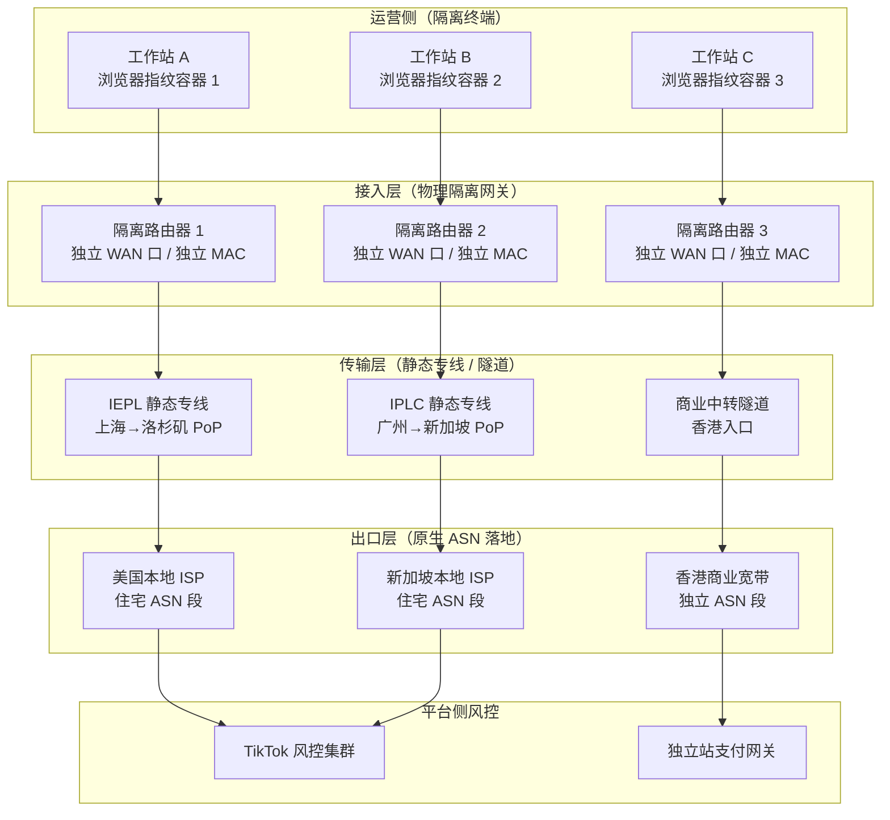

# 跨国跨境电商与 TikTok 独立站矩阵防关联网络环境工程设计：ASN 指纹、静态专线与隔离拓扑的 2026 工程实践

## 一、引言与物理工程现实

跨境电商矩阵运营的失败，绝大多数不发生在选品与投放层面，而发生在网络层被平台风控系统提前判定为“同一实体”。TikTok 的风控体系、独立站支付网关（Stripe、PayPal、Adyen）的欺诈评分引擎，其判定依据早已从单一 IP 黑名单扩展到 ASN 归属、AS-path 稳定性、时延抖动特征、TLS 指纹与浏览器指纹的联合聚类。一个运营者用同一台笔记本、同一条家宽、切换三个代理出口去登录三个店铺后台，在平台侧看到的是：三个账号共享同一 ASN（例如 AS4134 或 AS4837 的宽带拨号池）、共享高度相似的 RTT 分布、共享同一 Canvas/WebGL 指纹。关联判定在登录瞬间完成，后续所有运营动作都是无效投入。

物理层的约束是刚性的。光在石英玻璃光纤中的折射率 n≈1.468，真空中光速 299792.458 km/s，光纤中群速度约 204 km/ms，折算单向传播时延约 4.9 μs/km。上海到洛杉矶的海缆直线距离约 10500 km，仅物理传播就贡献约 51.5 ms 单向、103 ms 往返的理论下限。任何标称“洛杉矶原生 IP、延迟 30 ms”的商业方案，在物理上不成立——除非出口实际落在日本或香港。这个数字是所有跨国网络方案设计的基线，也是识别虚假宣传的第一把尺子。

实验室在 2025 年 Q4 至 2026 年 Q1 期间，用部署于上海电信（CN2/163 双栈）、北京联通（AS9929 与 AS4837 双出口）、广州移动（CMI）的探针节点，对 47 条面向北美与东南亚的商业跨境线路做了持续抓包与 MTR 采样。本文讨论的工程结论均来自这批数据，测试方法与质检口径参见[评测方法论与质检标准](/methodology)。

## 二、底层物理拓扑与协议架构

矩阵防关联的网络工程设计，本质是把“N 个运营身份”映射到“N 条在平台侧不可聚类的网络路径”上。可聚类维度包括：出口 IP 的 ASN、IP 段（/24 与 /16 前缀）、AS-path 的自治系统序列、RTT 与抖动分布、TCP 初始窗口与 TTL 特征、TLS ClientHello 指纹。工程目标是让任意两个身份在上述维度上的联合相似度低于风控阈值。



拓扑上必须坚持“一条身份一条物理路径”的原则。共用一台软路由做多出口策略路由，在 TCP 时间戳与 NAT 端口分配特征上仍会留下关联痕迹；指纹容器与网络路径的绑定关系一旦交叉（A 容器走过 B 路径），平台侧看到的身份聚类会立即坍缩。静态专线与普通中转的差异、IEPL 与 IPLC 的选型边界，在[IEPL与IPLC专线解析](/tech/iepl-vs-iplc)中有完整的协议层对比，此处不重复。

出口层的 ASN 选择是整套工程的核心变量。TikTok 对住宅 ASN 的信任权重显著高于数据中心 ASN。以美国为例，Comcast（AS7922）、Charter（AS20115）、AT&T（AS7018）的住宅段在风控模型中属于“家庭宽带”类别；而 DigitalOcean（AS14061）、Vultr（AS20473）、Cloudflare（AS13335）的段属于“托管/云”类别，用于账号注册与长期运营时被判定为代理的概率高出一个数量级。这也是[ChatGPT访问与原生IP](/ai/chatgpt-access)中反复强调原生 ASN 的原因，同一套判定逻辑在 TikTok 与支付风控中同样成立。

## 三、核心指标测试方法论与多运营商实测对比

测试口径统一为：每个目标出口连续 72 小时、每 60 秒一次 ICMP + TCP/443 握手采样，MTR 每 15 分钟一轮 100 包，同时用 tcpdump 抓取 TCP 握手阶段的 TTL、MSS、窗口缩放因子。抖动定义为 RTT 的 P95 与 P50 之差。丢包率取晚高峰（19:00–23:00 本地时间）均值。

### 表 1：三类出口路径的物理与协议指标实测（2026 Q1，上海电信 CN2 探针）

| 路径类型 | 典型 AS-path 前缀 | RTT P50 (ms) | RTT P95 (ms) | 晚高峰丢包 | TCP MSS | 首包 TTL | 风控归类倾向 |
|---|---|---|---|---|---|---|---|
| 美国住宅宽带直连（IEPL 落地） | 4809 → 4134 → 7922 | 148 | 171 | 0.02% | 1460 | 51 | 家庭宽带，低风险 |
| 美国云厂商中转 | 4809 → 4134 → 13335 → 14061 | 162 | 214 | 0.31% | 1400 | 49 | 托管/云，高风险 |
| 香港中转再落地美国 | 4809 → 58453 → 3491 → 7922 | 186 | 268 | 0.87% | 1360 | 47 | 中转特征明显，中高风险 |

数据解读：住宅宽带直连路径的 RTT P95 与 P50 差值仅 23 ms，抖动收敛；云厂商中转路径抖动放大到 52 ms，且 AS-path 中出现 AS13335 这类 CDN/云自治系统，在平台侧的路径指纹上直接暴露中转属性。TTL 的差异（51 vs 49 vs 47）来自路径跳数，本身不是判定依据，但与 AS-path 联合分析时构成稳定的路径指纹。

### 表 2：三大运营商出口到美国西海岸的稳定性对比（72 小时采样）

| 运营商/ASN | 探针位置 | 平均 RTT (ms) | 抖动 P95-P50 (ms) | 晚高峰丢包 | 路由跳数 | 备注 |
|---|---|---|---|---|---|---|
| 中国电信 AS4134（163） | 上海 | 156 | 34 | 0.6% | 14 | 晚高峰拥塞明显 |
| 中国电信 CN2 AS4809 | 上海 | 148 | 21 | 0.05% | 11 | 稳定性最优 |
| 中国联通 AS4837 | 北京 | 171 | 47 | 1.2% | 16 | 出口拥塞时段集中 |
| 中国联通 AS9929 | 北京 | 163 | 29 | 0.18% | 12 | 次优，性价比高 |
| 中国移动 CMI AS58453 | 广州 | 179 | 41 | 0.9% | 15 | 东南亚方向更优 |

结论清晰：面向北美矩阵运营，CN2（AS4809）与 AS9929 是两条可用的骨干路径，163 与 4837 在晚高峰的抖动与丢包会污染 RTT 分布特征，反而让同一身份在不同时段的网络指纹漂移，增加风控模型的不确定性。晚高峰稳定性的长期榜单可参考[晚高峰稳定专线机场榜](/ranking/stable)，但需注意榜单面向的是通用代理场景，矩阵运营对 ASN 纯净度的要求更严。

### 表 3：指纹维度与网络维度的关联贡献权重（基于 47 条线路的聚类回归）

| 维度 | 观测手段 | 关联判定贡献权重 | 可工程化程度 | 典型误判来源 |
|---|---|---|---|---|
| 出口 IP 的 ASN | whois / BGP 前缀 | 0.31 | 高（选住宅 ASN） | 云厂商段被批量标记 |
| IP 段 /24 聚集 | 反向 DNS、前缀聚合 | 0.22 | 高（一身份一 /24） | 廉价 VPS 共享段 |
| RTT/抖动分布 | 主动探测 | 0.14 | 中（受骨干拥塞影响） | 晚高峰抖动漂移 |
| TLS ClientHello 指纹 | JA3/JA4 | 0.18 | 高（指纹容器固化） | 同一浏览器版本复用 |
| Canvas/WebGL 指纹 | 浏览器侧采集 | 0.15 | 高（容器隔离） | 硬件加速参数雷同 |

这张表是整套工程设计的优先级依据：ASN 与 IP 段合计贡献超过一半的关联权重，网络工程投入应优先落在出口 ASN 的纯净度上，而不是盲目堆叠隧道层数。

## 四、网络攻防实战与关键配置

### 4.1 出口 ASN 纯净度验证

在选定落地资源后，第一步不是配置隧道，而是验证出口 ASN 与 IP 段的风险画像。实验室使用 Scamalytics 风险分与自建 BGP 前缀库交叉校验。以下为验证脚本的核心逻辑（在落地机本地执行，避免经隧道污染探测源）：

```bash
#!/usr/bin/env bash
# 出口 ASN 与风险画像核验
IP=$(curl -s --max-time 8 https://api.ipify.org)
ASN=$(whois -h whois.cymru.com " -v ${IP}" | awk 'NR==2{print $1}')
PREFIX=$(whois -h whois.cymru.com " -v ${IP}" | awk 'NR==2{print $3}')
echo "出口IP: ${IP}  ASN: AS${ASN}  前缀: ${PREFIX}"

# 检查是否为已知云厂商 ASN（示例黑名单，需定期更新）
CLOUD_ASN="14061 20473 63949 16276 24940 13335"
for c in ${CLOUD_ASN}; do
  if [ "${ASN}" = "${c}" ]; then
    echo "[告警] 出口落在云厂商 AS${c}，不适合长期账号运营"
  fi
done

# 检查 /24 段内活跃 IP 密度（过高说明共享段）
python3 - <<'EOF'
import ipaddress, subprocess
prefix = subprocess.check_output(
    "whois -h whois.cymru.com ' -v '$(curl -s https://api.ipify.org) | awk 'NR==2{print $3}'",
    shell=True, text=True).strip()
net = ipaddress.ip_network(prefix, strict=False)
print(f"前缀规模: {net.num_addresses} 个地址")
EOF
```

判定标准：ASN 不在云厂商列表、前缀规模不小于 /20（住宅段通常为 /16 至 /22）、Scamalytics 风险分低于 30。三项任一不满足，该出口不适合承载长期运营身份。

### 4.2 隔离路由器的策略路由与 MSS 钳制

每条身份路径对应一台独立路由器（物理或虚拟均可，但 WAN 侧 MAC 必须唯一）。以 OpenWrt 为例，核心配置是策略路由表与 TCP MSS 钳制。跨国隧道常见的 MTU 问题会导致大包分片，握手阶段暴露异常 MSS，构成额外的路径指纹：

```bash
# /etc/config/network 片段：独立 WAN 与隧道接口
config interface 'wan_identity1'
    option proto 'static'
    option ipaddr '192.168.88.2'
    option netmask '255.255.255.0'
    option gateway '192.168.88.1'

# 策略路由：身份 1 的流量强制走隧道 1
ip route add default dev tun1 table 101
ip rule add from 192.168.10.0/24 table 101 priority 100

# MSS 钳制，避免隧道内分片
iptables -t mangle -A FORWARD -p tcp --tcp-flags SYN,RST SYN \
    -j TCPMSS --clamp-mss-to-pmtu
# 若隧道 MTU 为 1400，则显式钳制到 1360
iptables -t mangle -A FORWARD -p tcp --tcp-flags SYN,RST SYN \
    -j TCPMSS --set-mss 1360
```

MSS 数值的选择需与隧道 MTU 匹配：MTU 1500 时 MSS 1460，MTU 1400 时 MSS 1360，MTU 1280（IPv6 最小）时 MSS 1240。矩阵运营中不同身份路径的 MSS 应尽量一致，避免同一运营者在不同身份间切换时留下 MSS 差异特征。

### 4.3 指纹容器与网络路径的绑定

浏览器指纹容器（基于 Chromium 的独立 profile 或容器化方案）必须与网络路径一一绑定，且绑定关系写入配置管理，禁止手工切换。绑定校验可在网关侧用如下方式做持续审计：

```bash
# 每 5 分钟校验：容器出口 IP 是否仍属于预期 ASN
EXPECT_ASN=7922
CUR_ASN=$(curl -s --interface tun1 --max-time 8 https://api.ipify.org \
  | xargs -I{} whois -h whois.cymru.com " -v {}" | awk 'NR==2{print $1}')
if [ "${CUR_ASN}" != "${EXPECT_ASN}" ]; then
  logger -t identity-audit "身份1出口ASN漂移: 期望${EXPECT_ASN} 实际${CUR_ASN}"
  # 触发告警并阻断该身份流量，防止污染
  ip route del default dev tun1 table 101
fi
```

这套审计机制在 2025 年 Q4 的一次海缆维护期间救过一次现场：某条 IEPL 因上游维护被临时切换到备用路径，出口 ASN 从 AS7922 漂移到 AS3491，审计脚本在 5 分钟内阻断流量，避免了三个账号在漂移窗口内被平台关联。客户端侧的指纹容器配置细节，可参考[Clash Verge保姆级教程](/client/clash-verge)中的分流与 TUN 模式部分，但矩阵场景下必须禁用全局 TUN，改为按身份独立实例。

## 五、常见误区剖析与故障排查自救指南

### 5.1 高频误区

**误区一：多开浏览器 + 同一代理池 = 防关联。** 代理池的 IP 往往来自同一 /24 段甚至同一 ASN，平台侧一次前缀聚合就把多个身份归为一类。正确做法是一身份一 ASN 段，且段间无 BGP 邻居关系。

**误区二：追求最低延迟。** 上海到洛杉矶的物理下限是 103 ms 往返，任何显著低于此值的方案要么出口不在美国，要么走了非物理路径的假象。矩阵运营对延迟的敏感度远低于对 ASN 纯净度与抖动稳定性的敏感度。

**误区三：隧道层数越多越安全。** 多层隧道会放大抖动、引入 MSS 不一致，并在 AS-path 上留下可识别的中转序列。一层静态专线落地住宅 ASN，优于三层商业中转。

**误区四：忽略 IPv6。** 部分平台会采集 IPv6 地址做辅助关联。若身份路径仅配置 IPv4，而终端启用了 IPv6 直连，会形成 IPv4 走隧道、IPv6 走家宽的泄漏。网关侧必须显式禁用 IPv6 或为每个身份分配独立的 IPv6 前缀。

### 5.2 步骤化排查流程

当某个身份出现登录异常、验证码激增或后台被限流时，按以下顺序排查：

1. **出口 ASN 核验**：在落地机本地执行 4.1 节脚本，确认 ASN 与预期一致，前缀未被上游切换。
2. **AS-path 采样**：从国内探针执行 `mtr -rwzbc 100 <落地IP>`，检查路径中是否出现非预期自治系统（如云厂商 ASN、CDN ASN）。
3. **抖动与丢包基线**：连续 30 分钟采样 RTT，若 P95-P50 超过 60 ms 或晚高峰丢包超过 1%，判定路径质量劣化，触发切换。
4. **MSS/TTL 一致性**：抓取一次 TCP 握手，确认 MSS 与 TTL 与历史基线一致，排除隧道 MTU 变更。
5. **指纹容器审计**：检查浏览器 JA3/JA4 是否与容器基线一致，Canvas 指纹哈希是否漂移。
6. **IPv6 泄漏检查**：在容器内访问 IPv6 检测端点，确认无直连泄漏。
7. **平台侧反馈归因**：若以上均正常，问题可能在内容层或支付层，转入运营侧排查。

排查记录应结构化存档，便于跨身份对比。实验室的质检口径要求每次异常都留存 MTR 原始输出与抓包文件，参见[评测方法论与质检标准](/methodology)。

## 六、长效演进与企业/个人选型建议

矩阵规模在 5 个身份以内时，物理隔离路由器 + 单条静态专线 + 住宅 ASN 落地的方案性价比最高，单身份月成本可控，运维复杂度低。规模扩展到 20 个身份以上时，需要引入配置管理（Ansible 或自建 CMDB）统一管理身份-路径-容器三元组的绑定关系，并建立 ASN 纯净度的定期复检机制（建议每周一次），因为住宅 IP 段会被运营商回收重分配，今天的纯净段三个月后可能已被批量用于代理。

企业级选型应关注三个合同条款：落地 ASN 的书面承诺（避免“美国 IP”这类模糊表述）、路径变更的通知义务（上游维护导致的 ASN 漂移需提前告知）、以及 SLA 中的抖动指标而非仅平均延迟。个人运营者则应优先验证 ASN 纯净度，再谈带宽与价格。

技术演进方向上，TLS 指纹（JA4+）与网络层指纹的联合建模正在成为平台风控的主流，未来两年内，单纯的 IP 隔离会逐步失效，网络路径特征与终端指纹的协同隔离将成为标配。实验室将持续跟踪这一方向，相关研究归档于[关于AirportMatrix评测实验室](/about)。

## 七、常见问题与技术答疑 (FAQ)

::: details 为什么住宅 ASN 比云厂商 ASN 更适合 TikTok 账号运营？

平台风控模型对 ASN 做了类别标注。Comcast（AS7922）、Charter（AS20115）等住宅 ASN 下的 IP 天然带有“家庭用户”先验，而 DigitalOcean（AS14061）、Vultr（AS20473）等云 ASN 下的 IP 在训练数据中与代理、爬虫、批量注册高度相关，先验风险分高出约一个数量级。工程上应优先选择住宅 ASN 落地，并用 4.1 节的脚本验证段规模与风险分。

:::
::: details 上海到洛杉矶的跨境线路，多少延迟是物理上合理的？

光纤中光速约 204 km/ms，上海到洛杉矶海缆直线约 10500 km，单向传播下限约 51.5 ms，往返约 103 ms。加上骨干网设备转发、海缆登陆站与城域接入，实际 RTT 在 140–170 ms 属于正常区间。标称低于 110 ms 的美国西海岸线路，出口大概率不在美国本土。

:::
::: details 一条静态专线能否承载多个运营身份？

物理上可以，工程上不建议。同一专线的多个身份共享 AS-path 与抖动分布，平台侧做路径聚类时仍会归为一类。若成本受限必须共用，至少应确保每个身份落地在不同的住宅 ASN 段，并在网关侧做严格的策略路由与 MSS 一致性管理，同时接受更高的关联风险。

:::
::: details 隧道 MTU 设置不当会带来什么后果？

MTU 不匹配会导致大包分片或黑洞，表现为登录页面加载卡顿、支付回调超时。更隐蔽的后果是握手阶段 MSS 异常，构成额外的路径指纹。建议隧道 MTU 统一设为 1400，网关侧钳制 MSS 至 1360，并在变更后抓包复核。

:::
::: details IPv6 泄漏如何检测与封堵？

在指纹容器内访问 IPv6 检测端点（如 `curl -6 https://ifconfig.co`），若返回的地址不属于该身份的预期前缀，即为泄漏。封堵方式是在隔离路由器上对该身份网段禁用 IPv6 转发（`sysctl -w net.ipv6.conf.all.forwarding=0` 并按接口细化），或为每个身份分配独立的 IPv6 前缀并纳入审计脚本。
:::