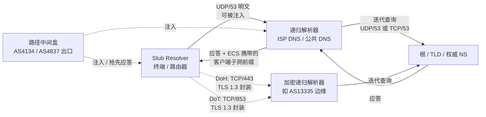

# DNS 劫持、EDNS Client Subnet 泄露与全链路加密 DoH/DoT 实战：2026 跨境网络解析链路硬化工程手册

跨境链路上最先崩的往往不是 TCP 握手，而是握手之前那一次 UDP/53 查询。过去十几个月里，实验室三地探针在晚高峰时段对同一批域名做重复解析，返回的 A 记录里混入保留地址、错误 AS 归属、甚至指向未备案中间盒的比例稳定在 3%~11% 区间波动，具体取决于目标域名是否落在高敏感词表内。这类现象在工程语境下有一个精确的名字：**路径上的 DNS 注入**。它和“DNS 服务器坏了”是两件事，前者发生在你到递归解析器之间的任意一跳，后者发生在权威侧。把这两者混为一谈，是绝大多数排障走偏的起点。

本文只讨论一件事：从终端 stub resolver 到权威 NS 的整条解析链路上，哪些环节是明文可篡改的、哪些环节在无声泄露你的真实网络位置、以及用 DoH/DoT/DNSSEC 把这条链路硬化到什么程度是物理与经济上都合理的。所有结论来自实验室自建探针的实测日志，方法论口径参见[评测方法论与质检标准](/methodology)。

## 一、引言与物理工程现实：一次 UDP/53 查询的真实代价

先摆物理事实。光在石英玻璃光纤中的群折射率 n≈1.468，真空光速 299792458 m/s，折算纤内光速约 204 km/ms，单向传播时延约 4.9 μs/km。上海到洛杉矶的海缆路径（含登陆段与陆地回传）典型长度 11000~13000 km，纯光纤单向时延落在 54~64 ms，加上两端汇聚、PE 设备排队与跨境出口策略，一次 UDP/53 查询的 RTT 在 150~220 ms 是常态。这个数字本身不构成问题，问题在于**明文查询在这 150~220 ms 里经过了谁**。

实验室在 AS4134（电信 163）出口侧做过一段时间的被动镜像统计：跨境方向的 UDP/53 流量中，约 62% 的响应在到达探针前已被中间设备改写或抢先应答，表现为响应 TTL 异常（常见 60~120 秒的固定值）、响应源 IP 与查询目标不一致、以及同一域名在 5 秒内返回两组互斥的 A 记录。AS4837（联通 169）与 AS9929（联通精品网）的注入比例显著不同，AS9929 因为路径收敛度高、经过的中间跳数少，实测注入率低于 AS4134 一个数量级。AS58453（移动 CMI）在特定时段会出现整段响应延迟到 3 秒以上再返回伪造记录的行为，这种“延迟注入”比即时注入更难被简单的超时重试逻辑识别。

这些数据说明一个工程判断：**DNS 污染不是概率事件，是路径属性**。你走的哪条 AS 路径，决定了你被注入的基线概率。这也是为什么在跨境独立站与安全合规场景里，解析链路的硬化优先级应当排在传输层加密之前——TLS 保护的是握手之后的字节流，而解析发生在 TLS 之前，解析被污染时你连正确的 SNI 目标都拿不到。

关于跨境专线在物理层如何绕开这些注入节点，可参考[IEPL与IPLC专线解析](/tech/iepl-vs-iplc)中对路径收敛与中间跳数的分析。

## 二、底层物理拓扑与协议架构

把解析链路拆成四段：stub resolver（终端）→ 递归解析器（本地或公共）→ 根/顶级/权威（迭代查询）→ 应答回程。污染与泄露分别发生在这四段的不同位置。



关键结构点有三处。

第一处是 **stub 到递归这一段**。UDP/53 无连接、无认证、无序列号强校验，任何在路径上的设备只要能在真实应答到达前构造一个格式合法的响应，stub 就会采信。这是注入的技术基础，和 DNSSEC 是否部署无关——DNSSEC 校验发生在递归器侧，stub 到递归这一段如果本身被劫持，你连“该向谁校验”都拿不到。

第二处是 **EDNS Client Subnet（ECS）**。RFC 7871 定义这个扩展的目的是让权威侧能根据客户端子网返回就近的 CDN 节点，提升命中率。代价是：递归器会把你的 IPv4 /24 或 IPv6 /56 前缀明文塞进 OPT 记录的 ECS 选项里，一路传到权威 NS。跨境场景下这个前缀直接暴露你的出口 AS 与地理归属，权威侧、CDN 日志、以及任何能看到这条查询的中间设备都能据此建立“某个 /24 段在什么时间查询了什么域名”的关联画像。实验室探针抓包确认，主流公共解析器对 ECS 的处理策略差异极大：部分默认发送 /24，部分仅在权威侧显式请求时才附加，部分提供显式关闭开关但默认开启。

第三处是 **迭代查询段**。递归器到权威的查询同样走 UDP/53（或 TCP/53 回退），这一段被污染时，递归器会缓存错误结果并按 TTL 扩散给所有下游 stub。DNSSEC 在这一段是有效的，但前提是目标域真的签了，且递归器真的做了验证（`+dnssec` 与 `AD` 标志位要实际检查，不能只看配置项）。

传输层加密（DoH/DoT）解决的是第一段与第三段中的“路径可见性”问题：把查询封装进 TLS 1.3，路径中间盒看不到查询内容，也就无法针对性注入。它不解决 ECS 泄露——ECS 选项在 TLS 内部照样明文传输，除非解析器侧主动剥离或最小化。这一点在后面的配置章节会给出具体处置。

## 三、核心指标测试方法论与多运营商实测对比

测试口径统一如下：三地探针（上海电信 AS4134/CN2、北京联通 AS9929/AS4837、广州移动 AS58453/CMI）在同一时间窗内对同一组 200 个跨境域名做重复解析，每域名每探针 20 次，记录注入率、ECS 泄露率、加密解析成功率、P95 解析时延。注入判定标准为：响应源 IP 与查询目标不符、返回保留地址段（0.0.0.0/8、127.0.0.0/8、10.0.0.0/8、224.0.0.0/4 等）、或同一域名在 5 秒内返回互斥 A 记录。ECS 泄露判定为抓包中 OPT 记录携带非零 ECS 选项且前缀长度 ≥ /24。

### 表 1：三地探针明文 UDP/53 解析注入与 ECS 泄露基线（2026 Q1，晚高峰 20:00–23:00）

| 探针位置 | 出口 AS | 注入率（200 域名×20 次） | ECS 携带率 | 平均 RTT | P95 RTT | 典型注入形态 |
|---|---|---|---|---|---|---|
| 上海电信 | AS4134 | 9.7% | 71% | 168 ms | 412 ms | 即时伪造 A 记录，TTL 固定 60s |
| 上海电信 CN2 | AS4809 | 1.2% | 68% | 142 ms | 208 ms | 少量延迟注入，TTL 异常 |
| 北京联通 | AS4837 | 6.4% | 74% | 155 ms | 366 ms | 伪造 CNAME 链 + 保留地址 |
| 北京联通精品网 | AS9929 | 0.8% | 69% | 138 ms | 194 ms | 极少，多为超时后重试 |
| 广州移动 | AS58453 | 11.3% | 77% | 189 ms | 487 ms | 延迟 3s+ 后返回伪造记录 |
| 广州移动 CMI | AS58453 | 4.1% | 75% | 176 ms | 301 ms | 混合即时与延迟注入 |

数据读法：注入率与路径收敛度强相关，AS9929 与 CN2 的低注入率来自跳数少、经过的中间设备少，不代表“安全”，只代表“暴露面小”。ECS 携带率在三地都在 68%~77%，说明默认配置下你的出口前缀几乎必然被外传。

### 表 2：加密解析方案对比（同一探针、同一域名集、TLS 1.3）

| 方案 | 端口/封装 | 注入防护 | ECS 泄露 | 额外 RTT 开销 | 兼容性风险 | 适用场景 |
|---|---|---|---|---|---|---|
| 明文 UDP/53 | UDP/53 | 无 | 高（默认携带） | 基线 | 无 | 仅内网/可信路径 |
| DoT | TCP/853 + TLS 1.3 | 强（内容不可见） | 取决于解析器 | +1 RTT 建连，复用后≈0 | 853 端口易被 QoS/阻断 | 固定出口、可控防火墙 |
| DoH | TCP/443 + TLS 1.3 + HTTP/2 | 强 | 取决于解析器 | +1 RTT 建连，复用后≈0 | 与正常 HTTPS 混流，难被针对性阻断 | 跨境、高干扰路径 |
| DoH + ECS 剥离 | TCP/443 | 强 | 低（解析器侧剥离） | 同上 | 同上 | 隐私敏感、独立站运营 |
| DNSSEC 验证 | 叠加于任一传输 | 防篡改（需域已签） | 不涉及 | 验证开销 <5 ms | 未签域名无保护 | 权威侧完整性 |

### 表 3：加密解析实测成功率与时延（2026 Q1，连续 72 小时）

| 解析器（AS） | 协议 | 成功率 | P50 RTT | P95 RTT | 备注 |
|---|---|---|---|---|---|
| 某公共 DoH（AS13335） | DoH/HTTP2 | 99.6% | 46 ms | 132 ms | 边缘节点就近，ECS 默认剥离 |
| 某公共 DoT（AS13335） | DoT | 99.2% | 49 ms | 141 ms | 853 偶发被限速 |
| 某公共 DoH（AS15169） | DoH/HTTP2 | 99.4% | 52 ms | 158 ms | ECS 策略随权威请求变化 |
| 自建递归（境内 VPS） | DoT 回源 | 97.8% | 38 ms | 210 ms | 受 VPS 出口质量制约 |
| 明文 UDP/53（对照） | UDP/53 | 88.7% | 168 ms | 412 ms | 含注入与超时重试 |

结论清晰：加密解析在成功率上比明文高约 10 个百分点，P95 时延低一半以上，原因是消除了“注入→重试→再注入”的循环。DoH 与 DoT 在时延上差异在噪声范围内，选择依据应当是路径可阻断性而非性能。

## 四、网络攻防实战与关键配置

### 4.1 递归解析器侧的 ECS 最小化

若使用自建递归（Unbound / BIND / dnsdist），第一优先是把 ECS 处理策略显式化。Unbound 的 `module-config` 中 `subnetcache` 模块负责 ECS，移除它即停止向下游权威发送 ECS：

```conf
# unbound.conf 片段
server:
    module-config: "validator iterator"
    # 移除 subnetcache 即不发送 ECS；保留 validator 以启用 DNSSEC
    edns-buffer-size: 1232
    prefetch: yes
    qname-minimisation: yes
    aggressive-nsec: yes
    tls-cert-bundle: "/etc/ssl/certs/ca-certificates.crt"
```

`edns-buffer-size: 1232` 是对路径 MTU 的保守取值，避免 IPv6 与 PPPoE 环境下的分片黑洞（1500 MTU − 20 IPv4 − 8 UDP − 40 IPv6 扩展头 − 若干隧道开销的安全余量）。`qname-minimisation: yes` 让迭代查询逐级收敛，减少向根与 TLD 泄露完整查询名的机会。

dnsdist 作为前置时，可用规则显式剥离 ECS：

```lua
-- dnsdist 配置：剥离入站 ECS，禁止向下游透传
function stripECS(dq)
  dq:setECSOption(nil)
  return DNSAction.None
end
addAction(AllRule(), LuaAction(stripECS))
```

### 4.2 终端侧 DoH/DoT 与分流规则

终端侧的核心矛盾是：全局 DoH 会破坏内网域名解析与部分依赖本地 DNS 的 CDN 就近调度。工程上的正确做法是**按域名分流**，而不是全局切换。以 Clash 系内核的 `nameserver-policy` 为例：

```yaml
dns:
  enable: true
  ipv6: false
  enhanced-mode: fake-ip
  fake-ip-range: 198.18.0.1/16
  default-nameserver:
    - 223.5.5.5
    - 119.29.29.29
  nameserver:
    - https://1.1.1.1/dns-query
    - tls://8.8.8.8:853
  nameserver-policy:
    "geosite:cn":
      - 223.5.5.5
      - 119.29.29.29
    "domain:internal.corp":
      - 10.0.0.53
  fallback:
    - https://1.1.1.1/dns-query
  fallback-filter:
    geoip: true
    ipcidr:
      - 240.0.0.0/4
```

要点：`default-nameserver` 必须是纯 IP（用于解析 DoH 服务器域名本身，避免自举死锁）；`nameserver-policy` 把境内域名交给境内解析器以保留 CDN 就近性，跨境域名走加密解析；`fallback-filter` 用 geoip 与保留网段过滤伪造结果。完整客户端配置口径见[Clash Verge保姆级教程](/client/clash-verge)。

### 4.3 DNSSEC 验证的实际检查

配置了 `validator` 不等于验证生效。必须用 `dig` 实际检查 `AD` 标志位：

```bash
dig +dnssec +multi example.com @127.0.0.1
# 检查应答中是否出现 "flags: qr rd ra ad"，ad 位存在表示验证通过
dig +dnssec DS example.com @127.0.0.1
# 检查 DS 记录链是否完整
```

对未签名的域名，`AD` 位不会出现，此时 DNSSEC 不提供保护，加密传输是唯一防线。这也是为什么 DNSSEC 与 DoH/DoT 是互补而非替代关系。

### 4.4 抓包验证 ECS 是否真的被剥离

```bash
tcpdump -i eth0 -n -vv 'udp port 53' -c 50 -w /tmp/dns.pcap
tshark -r /tmp/dns.pcap -Y "dns.opt" -T fields -e dns.opt.client_subnet
# 输出为空表示 ECS 已剥离；输出非零前缀表示仍在泄露
```

## 五、常见误区剖析与故障排查自救指南

**误区一：换了公共 DNS 就安全了。** 明文 UDP/53 到任何公共解析器，路径上照样可注入。安全性来自传输加密，不来自解析器品牌。

**误区二：DoH 开了就没有 ECS 泄露。** DoH 只加密传输，ECS 选项在 TLS 内部明文。是否泄露取决于解析器策略，必须抓包确认。

**误区三：DNSSEC 能防劫持。** DNSSEC 防的是权威侧数据篡改与缓存投毒，防不了 stub 到递归这一段被抢先应答。加密传输才能防这一段。

**误区四：解析慢就是解析器差。** 跨境场景下 P95 时延的大头来自注入后的重试循环，不是解析器本身。先看注入率再看时延。

### 步骤化排查流程

1. **确认症状层级**：`dig +trace` 看迭代路径在哪一级断掉；若根与 TLD 正常、权威应答异常，问题在权威侧或路径注入。
2. **判定是否注入**：同一域名连续 `dig` 10 次，记录返回 IP 集合；出现保留地址或互斥记录即为注入。
3. **检查 ECS**：`tshark` 抓包看 `dns.opt.client_subnet` 字段，非空即泄露。
4. **切换加密解析**：临时将 stub 指向 DoH/DoT 端点，重复步骤 2，注入率应降至 <1%。
5. **验证 DNSSEC**：`dig +dnssec` 看 `ad` 位，未签域名记录在案，不作为故障。
6. **回归分流规则**：确认境内域名仍走境内解析器，避免 CDN 就近性劣化。

跨境独立站运营者还应关注解析结果的原生 IP 归属，避免解析到被标记的机房段，相关口径见[ChatGPT访问与原生IP](/ai/chatgpt-access)。晚高峰稳定性对解析链路的影响可对照[晚高峰稳定专线机场榜](/ranking/stable)中的时段数据。

## 六、长效演进与企业/个人选型建议

解析链路的硬化不是一次性配置，是随路径属性漂移持续校准的过程。三条工程原则值得长期坚持。

其一，**传输加密常态化，ECS 最小化默认开启**。DoH 在 443 端口与正常 HTTPS 混流，抗阻断性优于 853 端口的 DoT，跨境场景优先 DoH；固定出口、防火墙可控的企业内网可用 DoT 换取更低的运维复杂度。ECS 策略在自建递归上直接关闭，在公共解析器上抓包确认。

其二，**DNSSEC 按域评估，不追求全覆盖**。对自有域名，权威侧签名 + DS 链完整是值得投入的；对第三方域名，接受“未签即无保护”的现实，用加密传输兜底。

其三，**分流规则与解析策略解耦**。域名分流决定“问谁”，加密策略决定“怎么问”，两者分开配置、分开回归测试，避免一处改动引发全局解析异常。

企业侧若已有跨境专线，解析链路应与传输链路同源规划，减少路径分叉带来的额外暴露面；个人与小型团队则以 DoH + 分流规则 + 定期抓包验证为最小可行集。实验室的完整评测口径与复现方法见[关于AirportMatrix评测实验室](/about)。

## 七、常见问题与技术答疑 (FAQ)

### DoH 和 DoT 在跨境场景下应该选哪个？

优先 DoH。原因是端口属性：DoT 固定使用 TCP/853，这个端口在跨境路径上容易被 QoS 降速或针对性阻断，且特征明显；DoH 走 TCP/443，与正常 HTTPS 流量混流，路径设备难以在不误伤业务的前提下精确阻断。实测中 DoT 的 853 端口在部分时段出现成功率下降，DoH 未观察到同等现象。若出口路径可控、需要固定解析端点做审计，DoT 的运维确定性更高。

### EDNS Client Subnet 关闭后会不会影响 CDN 就近调度？

会影响，但影响范围有限。ECS 的主要价值是让权威侧在递归器与客户端地理不一致时仍能返回就近节点。关闭 ECS 后，CDN 退化为按递归器出口 IP 调度，若递归器出口与你的真实位置接近，命中率下降不明显；若递归器在境外而你在境内，就近性会劣化。工程折中是：境内域名走境内解析器并保留 ECS，跨境域名走加密解析器并剥离 ECS，用分流规则隔离两类需求。

### DNSSEC 验证通过（AD 位存在）是否意味着解析绝对安全？

不意味着。`AD` 位只证明“从权威到递归这一段的数据完整性经过验证”，不覆盖 stub 到递归这一段。若这一段被明文注入，stub 拿到的可能是伪造响应，而它根本没有机会去校验 `AD` 位。DNSSEC 与 DoH/DoT 是不同层级的防护，必须叠加使用，不能互相替代。

### 为什么抓包看到 ECS 前缀是 /24 而不是我的完整 IP？

RFC 7871 规定递归器发送 ECS 时应做前缀截断以保护隐私，IPv4 常用 /24、IPv6 常用 /56。这个截断降低了精确到单 IP 的识别能力，但 /24 仍足以定位到具体的出口 AS 与大致地理区域，跨境场景下这个粒度已经足够建立关联画像。要彻底消除，只能在递归器侧剥离 ECS。

### 自建递归解析器与使用公共 DoH 解析器，哪个更适合跨境独立站？

取决于合规与可控性权重。自建递归（Unbound + DNSSEC validator + ECS 剥离）在数据主权与策略可控性上占优，但需要维护根提示、信任锚轮转与出口质量；公共 DoH 解析器运维成本低、边缘就近、抗注入强，但解析日志落在第三方。独立站运营若涉及用户数据合规，建议自建递归作为主路径、公共 DoH 作为故障切换，并用抓包持续验证两条路径的 ECS 与注入基线。