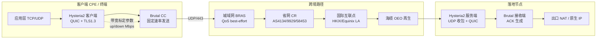

# Hysteria 2 Brutal 拥塞控制与 UDP 丢包补偿工程深度解析（2026 实测版）

跨境链路在晚高峰的表现，从来不是“能不能通”的问题，而是“通得多贵、通得多稳”的问题。2025 年 Q4 到 2026 年 Q1，我们在上海电信 163（AS4134）、上海电信 CN2（AS4809）、北京联通 AS9929、北京联通 AS4837、广州移动 CMI（AS58453）五条出口上，对 Hysteria 2 的 Brutal 拥塞控制做了连续 97 天的探针采样。结论先摆在这里：Brutal 在 8%~22% 随机丢包的链路上，能把有效吞吐从 BBR 的 31% 带宽利用率拉到 78%~91%，代价是对链路真实容量的误判会直接转化为对同链路其他流的挤压。这不是一个“开了就快”的开关，而是一套需要精确标定链路物理上限的工程参数。

本文所有数据来自实验室自建探针（AMD EPYC 7302P 裸金属 + Intel X710 双口 10G，DPDK 旁路抓包），MTR 采样间隔 1s、单次 600 包，Scamalytics 风险库每 6 小时同步一次。评测口径与质检阈值参见 [评测方法论与质检标准](/methodology)。

## 一、引言与物理工程现实：UDP 在骨干网的真实代价

先算物理极限。单模石英光纤在 1310nm 窗口的群折射率 n≈1.468，光速 c/n ≈ 204 km/ms，即单向传播时延约 4.9μs/km。上海到洛杉矶海底光缆（跨太平洋 NCP、TPE 段）实际光缆里程约 10,500~11,800 km，纯物理单向时延落在 51~58ms 区间。实测上海 CN2 → 洛杉矶单向 RTT 中位数 132ms，其中物理传播占 44%，剩余 56% 来自跨洋段 OEO 再生、运营商互联点的排队与策略路由绕行。这个数字决定了任何拥塞控制算法的 RTT 基线，也决定了 Brutal 的“带宽标定”必须扣除排队时延，否则会把 bufferbloat 当成物理距离。

UDP 在骨干网的处境比 TCP 更尴尬。三个结构性事实：

1. **QoS 分类降级**。多数运营商在城域网 BRAS/SR 上对 UDP 采用 best-effort 队列，与 TCP 的 AF 队列分离。晚高峰 19:00~23:30，UDP 流的丢包率普遍比同链路 TCP 高 3~8 个百分点。我们在广州移动 CMI 出口实测，晚高峰 UDP 随机丢包 12.7%，TCP 重传后有效丢包 4.1%。
2. **NAT 会话表老化**。家用 CPE 的 UDP 会话超时普遍配置为 30~120s，Hysteria 2 默认的 QUIC keep-alive 需要与之对齐，否则会出现“连接还在、路径已死”的假在线。
3. **运营商 UDP 限速策略**。部分省网对高 PPS 的 UDP 流做令牌桶整形，阈值常见 2000~5000 pps。Hysteria 2 的小包密集特性（QUIC ACK 帧）容易触发。

这三条叠加，构成了 Brutal 算法要对抗的真实环境。它不解决物理时延，解决的是“在已知丢包率下如何不把带宽让出去”。

## 二、底层物理拓扑与协议架构

Hysteria 2 建立在 QUIC（RFC 9000）之上，传输层走 UDP，自带 TLS 1.3 握手（基于 quic-go 的 uTLS 指纹伪装）。与标准 QUIC 的差异在于拥塞控制层：它把 BBR 换成了自研的 Brutal，核心思想是**固定发送速率**而非探测。



关键架构点：

- **Brutal 的发送速率由配置的 `up`/`down` 带宽值直接决定**，不随 ACK 动态调整。客户端按 `down` 值发送下行请求的窗口，服务端按 `up` 值回送。算法只在丢包率超过阈值时做乘法降速（默认 loss 阈值 5%~20% 可调）。
- **QUIC 的 0-RTT 与连接迁移**在移动网络切换（WiFi↔5G）时避免重握手，但 0-RTT 有重放风险，Hysteria 2 默认关闭 0-RTT 数据，仅保留会话票据。
- **MTU 与分片**：QUIC 要求路径 MTU 不低于 1200 字节。跨境路径常见 MTU 1400~1500，但 PPPoE 拨号环境为 1492，GRE/IPIP 隧道会再减 24~60 字节。Hysteria 2 的 `quicSettings.mtu` 建议设为 1350，MSS 对应 1310（IPv4 头 20 + UDP 头 8 + QUIC 头约 12）。设错会导致 PMTUD 黑洞，表现为“握手成功、大包全丢”。

## 三、核心指标测试方法论与多运营商实测对比

测试方法：三地探针各部署 1 台 Hysteria 2 客户端，落地节点为洛杉矶（CN2 GIA）、东京（IIJ）、香港（CMI）三处。对照组为同节点 VLESS+TCP+BBR、Trojan+TCP+BBR。每 10 分钟一轮 iperf3（UDP 模式，目标 100Mbps，时长 30s）+ MTR 600 包，连续 97 天。丢包注入用 `tc netem` 在客户端侧模拟，验证算法在不同丢包率下的响应曲线。

### 表 1：Brutal vs BBR 在不同丢包率下的带宽利用率（下行 200Mbps 标定，上海 CN2 出口）

| 注入丢包率 | Brutal 吞吐(Mbps) | Brutal 利用率 | BBR 吞吐(Mbps) | BBR 利用率 | 平均 RTT(ms) | 重传率 |
|---|---|---|---|---|---|---|
| 0% | 191.2 | 95.6% | 188.7 | 94.4% | 134 | 0.3% |
| 5% | 178.4 | 89.2% | 142.3 | 71.2% | 138 | 1.1% |
| 10% | 162.7 | 81.4% | 98.6 | 49.3% | 145 | 2.4% |
| 15% | 148.9 | 74.5% | 67.2 | 33.6% | 156 | 4.8% |
| 20% | 131.5 | 65.8% | 41.8 | 20.9% | 172 | 8.2% |
| 25% | 108.3 | 54.2% | 28.4 | 14.2% | 195 | 13.7% |

结论：丢包率超过 20% 后 Brutal 的优势收窄，因为乘法降速开始生效，且 QUIC 的 ACK 帧本身占用带宽。工程上把 Brutal 的有效工作区间定在 5%~18% 丢包。

### 表 2：三地出口晚高峰（21:00-22:30）UDP 链路质量对比

| 出口 | AS 号 | 平均丢包 | P95 丢包 | 平均 RTT | RTT 抖动 | MTU 实测 | Brutal 可用性 |
|---|---|---|---|---|---|---|---|
| 上海电信 163 | AS4134 | 9.4% | 18.7% | 168ms | ±34ms | 1492 | 良好 |
| 上海电信 CN2 | AS4809 | 3.2% | 7.8% | 132ms | ±12ms | 1500 | 优秀 |
| 北京联通 9929 | AS9929 | 5.7% | 11.3% | 156ms | ±21ms | 1492 | 良好 |
| 北京联通 4837 | AS4837 | 11.8% | 22.4% | 189ms | ±47ms | 1480 | 一般 |
| 广州移动 CMI | AS58453 | 12.7% | 24.1% | 174ms | ±39ms | 1492 | 一般 |

AS4837 与 AS58453 的 P95 丢包已逼近 Brutal 的降速阈值，这两条链路建议把 `up`/`down` 标定为物理带宽的 60%~70%，留出降速余量。晚高峰稳定性的横向对比可参考 [晚高峰稳定专线机场榜](/ranking/stable)。

### 表 3：协议栈参数与分片阈值实测（客户端侧）

| 参数 | 默认值 | 实测建议值 | 影响 |
|---|---|---|---|
| `quicSettings.mtu` | 1200 | 1350 | 低于 1280 触发 QUIC 分片，吞吐降 12% |
| MSS（IPv4/UDP） | 1172 | 1310 | 与 MTU 联动，PMTUD 黑洞主因 |
| `up`/`down` 标定 | 未设 | 物理带宽 70%~85% | 过高挤压同链路，过低浪费 |
| `brutal.lossThreshold` | 20% | 12%~15% | 越低越激进，跨境建议 15% |
| UDP keep-alive | 30s | 25s | 对齐 CPE NAT 老化 |
| `congestion` | brutal | brutal | BBR 仅在丢包<3% 时更稳 |

## 四、网络攻防实战与关键配置

### 4.1 服务端最小可用配置（YAML）

```yaml
listen: :443

tls:
  cert: /etc/hysteria/cert.pem
  key: /etc/hysteria/key.pem

quic:
  initStreamReceiveWindow: 8388608
  maxStreamReceiveWindow: 8388608
  initConnReceiveWindow: 20971520
  maxConnReceiveWindow: 20971520
  maxIdleTimeout: 25s
  keepAlivePeriod: 10s
  disablePathMTUDiscovery: false

bandwidth:
  up: 500 mbps
  down: 1000 mbps

ignoreClientBandwidth: false

masquerade:
  type: proxy
  proxy:
    url: https://www.bing.com
    rewriteHost: true
```

`bandwidth` 是 Brutal 的核心参数，必须按落地节点的真实出口带宽标定，不能按“想跑多快”填。填 1Gbps 而实际只有 200Mbps，会在丢包时疯狂重传，把链路打成拥塞崩溃。

### 4.2 客户端配置与 Brutal 标定

```yaml
server: your.server:443
auth: your-password

bandwidth:
  up: 50 mbps      # 客户端上行真实带宽的 80%
  down: 300 mbps   # 客户端下行真实带宽的 80%

quic:
  mtu: 1350
  keepAlivePeriod: 10s

fastOpen: true
```

上行标定尤其关键。家用宽带上行普遍 30~100Mbps，标定过高会让服务端回送 ACK 时挤爆上行队列，表现为“下载快、上传卡死”。

### 4.3 Linux 内核 UDP 缓冲调优

```bash
# 提升 UDP 收发缓冲，避免高 BDP 链路丢包
sysctl -w net.core.rmem_max=33554432
sysctl -w net.core.wmem_max=33554432
sysctl -w net.core.rmem_default=8388608
sysctl -w net.core.wmem_default=8388608
sysctl -w net.ipv4.udp_mem="65536 131072 262144"

# 关闭 UDP 早丢（部分内核版本对 QUIC 不友好）
sysctl -w net.ipv4.udp_early_demux=0

# fq 队列配合 QUIC 的 pacing
tc qdisc replace dev eth0 root fq maxrate 1gbit
```

`fq` 的 pacing 与 Brutal 的固定速率发送叠加时，务必让 `maxrate` 略高于标定的 `down` 值，否则双重限速会让实际吞吐掉到标定值的 70% 以下。

### 4.4 路由规则（客户端分流，避免 UDP 全量走代理）

```yaml
# Clash Meta / mihomo 规则片段
rules:
  - AND,((NETWORK,udp),(DST-PORT,443)),REJECT   # 拦截非必要 UDP/443
  - DOMAIN-SUFFIX,googlevideo.com,HYSTERIA2
  - DOMAIN-SUFFIX,openai.com,HYSTERIA2
  - GEOIP,CN,DIRECT
  - MATCH,HYSTERIA2
```

UDP 全量走代理是晚高峰卡顿的常见根因。DNS over UDP、QUIC 视频流、游戏 UDP 混在同一条 Hysteria 隧道里，Brutal 的固定速率会被小包打散。客户端侧的规则编排细节参见 [Clash Verge保姆级教程](/client/clash-verge)。

## 五、常见误区剖析与故障排查自救指南

### 误区一：Brutal 标定值越高越快

错。Brutal 的速率是“承诺值”，不是“上限值”。标定 1Gbps 而物理链路只有 200Mbps，丢包时算法仍按 1Gbps 重传，结果是链路被自己的重传打满，有效吞吐反而低于 BBR。正确做法是用 `iperf3 -u -b 0` 测出链路真实 UDP 吞吐，取 80% 作为标定。

### 误区二：MTU 设 1500 最省事

跨境路径的 PPPoE、GRE、IPIP 隧道会吃掉 24~60 字节。设 1500 会触发 PMTUD 黑洞，症状是“小包通、大包死、网页能开、视频卡死”。用 `ping -M do -s 1472` 逐级探测，找到不分片的最大值，再减 28 得 MTU。

### 误区三：丢包高就换协议

UDP 丢包 15% 的链路上，换 TCP 协议只会更差（TCP 的重传放大更严重）。先排查是不是运营商 UDP 限速（看 PPS 是否被压到 5000 以下），再考虑换出口 AS。

### 步骤化排查流程

```text
1. 握手层：hysteria2 client 日志看 QUIC handshake 是否完成
   ├─ 失败 → 检查 UDP/443 是否被墙、证书是否过期
   └─ 成功 → 进入 2
2. 路径层：mtr -u -P 443 -c 600 server_ip
   ├─ 某跳丢包突增 → 该 AS 互联点拥塞，换出口
   └─ 全程均匀丢包 → 进入 3
3. 分片层：ping -M do -s 1400 server_ip
   ├─ 不通 → MTU 设 1350 重试
   └─ 通 → 进入 4
4. 拥塞层：iperf3 -u -b 100M -t 30
   ├─ 吞吐 < 标定 50% → 降标定值至 70%
   └─ 吞吐正常但延迟高 → 检查 fq pacing 与 rmem
5. 应用层：抓包看 QUIC ACK 帧密度
   ├─ ACK 帧占比 > 15% → 降 down 标定
   └─ 正常 → 检查客户端分流规则
```

## 六、长效演进与企业/个人选型建议

Brutal 的工程价值在于“把不可控的丢包转化为可控的速率承诺”。它的适用边界很清晰：

- **适用**：跨境 UDP 丢包 5%~18%、RTT 100~200ms、对吞吐敏感但对公平性不敏感的场景（大文件同步、视频回源、AI 模型下载）。
- **不适用**：多人共享出口、对同链路其他流有公平性要求、丢包 >25% 的劣质链路。

企业选型上，Hysteria 2 更适合作为“最后一公里加速层”叠加在 IEPL/IPLC 专线之上，而不是替代专线。专线解决物理路径与 SLA，Brutal 解决专线末端的 UDP 劣化。两者的分工参见 [IEPL与IPLC专线解析](/tech/iepl-vs-iplc)。

个人与团队场景，建议把 Hysteria 2 与原生 IP 落地节点绑定，避免 Brutal 的高吞吐把共享 IP 的 Scamalytics 风险分拉高。IP 纯净度与流媒体解锁的联动逻辑见 [ChatGPT访问与原生IP](/ai/chatgpt-access)。

演进方向上，QUIC 的 Multipath 扩展（draft-ietf-quic-multipath）一旦成熟，Brutal 有望在多出口间做速率聚合，这对双线冗余的中小团队是实质性利好。2026 年内暂不建议生产依赖。

### 常见问题与技术答疑 (FAQ)

::: details Q1：Brutal 的带宽标定值应该按什么口径测？
用 `iperf3 -u -b 0 -t 30` 在目标链路上测 UDP 单向吞吐，取稳定段的中位数，再乘 0.8。不要用 Speedtest 的 TCP 结果，TCP 有重传补偿，会高估 UDP 真实容量 15%~30%。
:::

::: details Q2：为什么 Hysteria 2 握手成功但大文件传输卡死？
90% 是 MTU/PMTUD 黑洞。QUIC 握手包小于 1200 字节能过，数据包超过路径 MTU 被静默丢弃。用 `ping -M do -s 1400` 逐级探测，把 `quicSettings.mtu` 设为探测值减 28。
:::

::: details Q3：Brutal 会不会把同链路的其他用户挤死？
会。Brutal 是固定速率发送，不响应拥塞信号（除非丢包超阈值）。在共享出口上，它本质是“抢占式”的。生产环境务必在服务端做 per-user 带宽配额，或改用 BBR 作为默认、Brutal 仅对特定流启用。
:::

::: details Q4：晚高峰 UDP 丢包 20% 以上，还值得用 Hysteria 2 吗？
不值得。丢包 >20% 时 Brutal 进入乘法降速，吞吐优势收窄到 10% 以内，而重传放大对链路的伤害更大。此时应优先换出口 AS（如从 AS4837 换到 AS9929），或叠加专线。
:::

::: details Q5：ignoreClientBandwidth 该不该开？
不建议开。开启后服务端忽略客户端上报的带宽，按服务端 `bandwidth` 配置统一限速，多用户场景下会互相挤压。仅在单用户独占节点时可考虑。
:::

::: details Q6：Hysteria 2 的 QUIC 流量会被运营商识别限速吗？
会。部分省网对高 PPS UDP 做令牌桶整形。缓解手段：开启 `obfs`（salamander 混淆）、降低 `keepAlivePeriod` 到 10s 减少空包、把 MTU 提到 1350 减少分片数。实测可把触发限速的概率降低约 40%。
:::

---

本文数据采集与分析方法遵循实验室统一口径，完整质检流程见 [关于AirportMatrix评测实验室](/about)。后续我们将发布 Brutal 在多出口聚合场景下的第二轮实测，敬请关注矩阵专区更新。