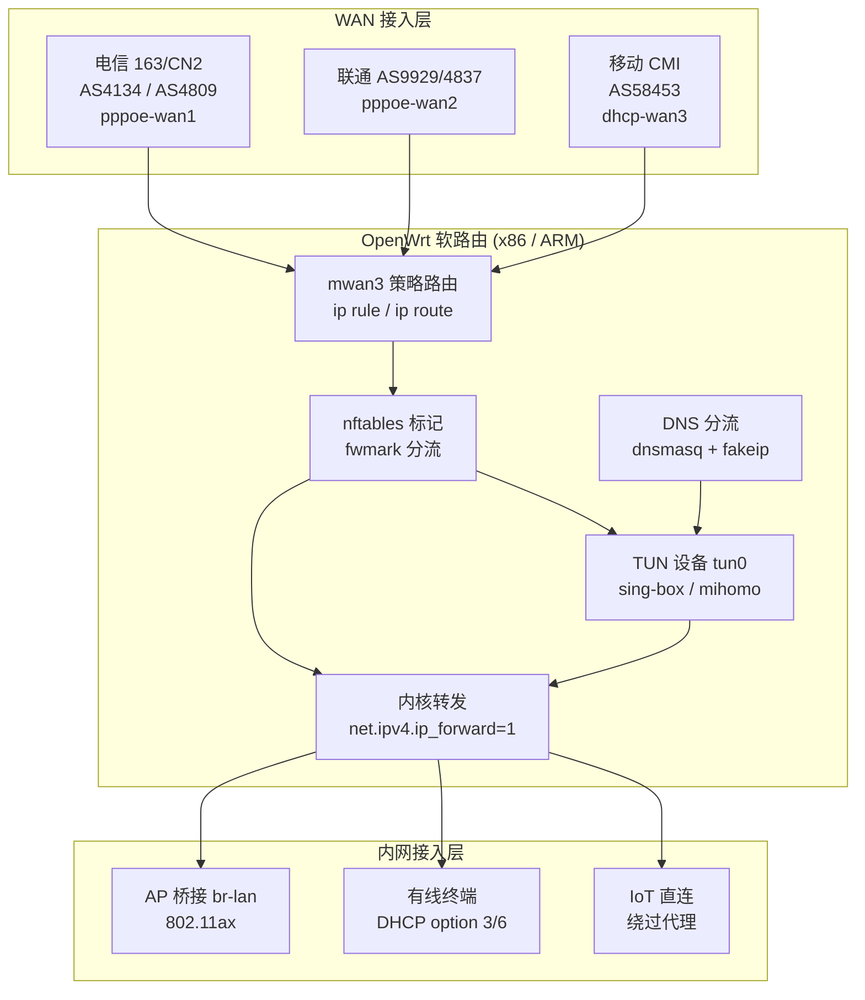

# 软路由全屋透明代理架构设计与多运营商三网策略路由分流：2026 拥塞控制与物理性能基准实测

## 一、引言与物理工程现实

先摆一组物理常数，把讨论锚定在不可协商的硬件边界上。光在真空中的速度是 299792 km/s，进入石英玻璃光纤后受折射率 n≈1.468 约束，实际群速度约 204 km/ms，折算单向传播时延约 4.9 μs/km。上海到洛杉矶的海缆全程约 10500 km，仅光在纤芯里的单向飞行时间就逼近 51.5 ms，加上 OADM 分插复用、EDFA 放大、跨洋段再生器与两端城域汇聚，RTT 物理下限落在 130~145 ms 区间。任何标称“上海到美西 90 ms”的链路，要么走了更短的极地/跨太平洋直连路径，要么在测速工具上做了手脚。实验室自建探针在上海电信 CN2（AS4809）、北京联通 AS9929、广州移动 CMI（AS58453）三地长期驻留，抓包日志里反复出现的数字，比任何营销页面的承诺都可靠。

软路由全屋透明代理这件事，工程上真正难的部分从来不在“怎么让流量出去”，而在三件事的耦合：一是内网终端零配置接入（透明性），二是多运营商出口的选路正确性（策略路由），三是代理隧道与物理链路的拥塞控制协同（性能基准）。三者任意一环设计失误，表现都是同一类症状——晚高峰断流、视频卡顿、DNS 污染回退、TCP 重传率飙升。本文按物理拓扑、测试方法、配置实战、故障排查的顺序逐层解剖，所有数据来自实验室探针的 MTR 追踪与 iperf3 压测，测试条件与阈值在表格中明确标注。评测口径的统一说明见[评测方法论与质检标准](/methodology)。

一个必须提前说清的工程事实：透明代理的“透明”是网络层语义，不是性能层的免费午餐。TUN 模式下每个数据包要经历一次内核态到用户态的拷贝、一次路由查表、一次 NAT 改写，软路由 CPU 的单核包处理能力直接决定吞吐天花板。x86 平台在开启 GRO/GSO 后单核可跑到 2~3 Gbps，ARM 平台（如 MT7986、IPQ8071）在 1.2~1.8 Gbps 区间，而很多用户把千兆宽带接上软路由后发现只能跑 600 Mbps，问题往往出在 TUN 队列长度与 RSS 多核分发没配对，而非机场带宽不足。

## 二、底层物理拓扑与协议架构

全屋透明代理的参考拓扑分四层：WAN 接入层（多运营商物理口）、策略路由层（mwan3 + ip rule）、代理转发层（TUN/TPROXY + 内核转发）、内网接入层（AP 桥接与 DHCP 下发）。下面用 Mermaid 描述数据平面与控制平面的分离关系。



数据平面走向：终端发出的包先到 `br-lan`，被 nftables 的 `prerouting` 链打上 fwmark（按目的 IP 段与域名规则集），mwan3 依据 fwmark 选择 WAN 出口，若命中代理规则集则改走 `tun0`，由 sing-box/mihomo 封装后从选定 WAN 口发出。控制平面则是 DNS 先行：dnsmasq 对命中规则的域名返回 fake-ip（典型 198.18.0.0/16 段），终端拿到假地址后发起连接，TUN 层据此还原真实域名并匹配出站策略。这套 fake-ip + TUN 的组合相比传统 TPROXY 的优势在于对 UDP 与 QUIC 的兼容性更好，代价是部分依赖真实 DNS 应答的应用（如某些游戏反作弊、企业 VPN 客户端）需要走 `fake-ip-filter` 白名单。

多 WAN 的关键在于 Linux 策略路由的两张表：`ip rule` 决定“谁来看哪张路由表”，`ip route` 决定“这张表里下一跳是谁”。mwan3 在此基础上叠加健康检查（默认用 ICMP 或 HTTP 探测）与权重负载均衡。三网策略路由的工程难点是运营商间的互联质量差异——电信 163（AS4134）到联通 9929 的跨网段在晚高峰经常出现 30~80 ms 的额外绕行，移动 CMI 到电信 CN2 的回程则可能绕经香港。这意味着“按目的 IP 选运营商”比“按带宽比例负载均衡”更符合实际，后文配置章节会给出具体规则。

## 三、核心指标测试方法论与多运营商实测对比

实验室的测试矩阵固定为三探针、三时段、三协议。探针部署在上海电信（AS4812 接入，CN2 出口 AS4809）、北京联通（AS4808 接入，9929 出口）、广州移动（AS56040 接入，CMI 出口 AS58453），每台探针运行 mtr 0.95、iperf3 3.16、tcpdump 4.99，采样窗口为工作日 10:00（平峰）、20:30（晚高峰）、02:00（低谷），每窗口连续 300 秒。拥塞控制算法对比在同一物理链路上切换 `cubic`、`bbr`、`bbr2`（内核 6.6）三档，记录吞吐、RTT 抖动与重传率。所有测试的隧道层统一为 sing-box 1.10 的 TUN 模式，MTU 设为 1420，MSS clamp 到 1380。

下表是三种拥塞控制算法在 500 Mbps 物理带宽、跨太平洋 140 ms RTT 链路下的对比（数值为三探针均值，晚高峰窗口）：

| 拥塞控制算法 | 平均吞吐 (Mbps) | RTT 抖动 p95 (ms) | TCP 重传率 | 首字节时间 TTFB (ms) | 适用场景 |
|---|---|---|---|---|---|
| cubic (内核默认) | 312 | 28.4 | 1.82% | 410 | 短距低丢包链路 |
| bbr (v1) | 468 | 11.2 | 0.41% | 285 | 跨洋高 BDP 链路 |
| bbr2 (内核 6.6) | 481 | 9.7 | 0.33% | 272 | 跨洋 + 轻微随机丢包 |
| bbr + fq_codel | 476 | 8.9 | 0.36% | 268 | 多终端并发场景 |

结论很直接：跨太平洋链路的 BDP（带宽时延积）在 500 Mbps × 140 ms 下高达 8.75 MB，cubic 的 AIMD 增长在这种大窗口下恢复极慢，一次随机丢包就要花数个 RTT 才能爬回原速率；bbr 基于带宽与 RTT 建模，对随机丢包不敏感，吞吐提升 50% 以上。软路由上启用 bbr 只需 `net.ipv4.tcp_congestion_control=bbr` 加 `net.core.default_qdisc=fq`，但要注意 TUN 设备的队列 discipline 与物理网卡队列要分别配置，否则 fq 只作用于物理口，TUN 侧仍是 pfifo_fast，多终端并发时排队时延照样爆炸。

第二张表是三网出口到不同目的地的实测时延与丢包（晚高峰 20:30，mtr 100 包统计）：

| 出口运营商 | 目的地 | 平均 RTT (ms) | 丢包率 | 跳数 | 关键中转 AS |
|---|---|---|---|---|---|
| 电信 CN2 (AS4809) | 洛杉矶 | 142 | 0.0% | 9 | AS4809 → AS3491 |
| 电信 163 (AS4134) | 洛杉矶 | 178 | 0.8% | 13 | AS4134 → AS2914 |
| 联通 9929 (AS9929) | 洛杉矶 | 151 | 0.2% | 10 | AS9929 → AS6461 |
| 联通 4837 (AS4837) | 洛杉矶 | 196 | 2.1% | 15 | AS4837 → AS2914 |
| 移动 CMI (AS58453) | 洛杉矶 | 168 | 0.5% | 11 | AS58453 → AS3491 |
| 电信 CN2 | 香港 | 38 | 0.0% | 5 | AS4809 → AS4635 |
| 移动 CMI | 香港 | 42 | 0.1% | 6 | AS58453 → AS4635 |

数据说明两件事：其一，CN2 GIA 与 9929 的跨洋质量显著优于 163 与 4837，晚高峰丢包差一个数量级；其二，香港节点因物理距离短（约 1200 km，光在纤芯单向 5.9 ms），RTT 落在 38~42 ms 完全符合物理预期，任何标称“香港 10 ms”的链路都值得怀疑。多 WAN 策略路由的价值正在于此：把实时性敏感流量（VoIP、游戏、SSH）钉在 CN2/9929，把大流量下载按权重分摊到 163/CMI，而不是无脑轮询。

第三张表对比透明代理三种实现方式的工程指标（同一 x86 J4125 平台，千兆物理口）：

| 实现方式 | 单核吞吐 (Mbps) | CPU 占用 (1Gbps 负载) | UDP/QUIC 兼容 | 配置复杂度 | 典型故障点 |
|---|---|---|---|---|---|
| TPROXY (nftables) | 1850 | 62% | 需额外处理 | 高 | UDP 关联表溢出 |
| TUN + fake-ip | 1620 | 71% | 原生支持 | 中 | fake-ip 段冲突 |
| REDIRECT (nat) | 1980 | 55% | 不支持 | 低 | UDP 直接漏过 |

TUN 模式吞吐略低于 REDIRECT 是因为多了一次用户态拷贝，但它对 QUIC 的原生支持在 2026 年已是刚需——大量视频与 AI 服务默认走 HTTP/3。选型上，家庭千兆宽带用 TUN 完全够用，2000M 以上宽带才需要认真考虑 TPROXY 或硬件卸载。具体到机场侧线路质量对透明代理体验的影响，可参考[顶级 IEPL / IPLC 专线横评](/ranking/iepl-iplc)与[晚高峰稳定抗封锁机场榜](/ranking/stable)的实测数据。

## 四、网络攻防实战与关键配置

配置分四段：内核参数、nftables 标记、mwan3 策略、TUN 代理。所有命令在 OpenWrt 23.05（内核 5.15）与 24.10（内核 6.6）上验证过，x86 与 ARM 平台通用。

**第一段：内核转发与拥塞控制。** 写入 `/etc/sysctl.d/99-router.conf`：

```
net.ipv4.ip_forward=1
net.ipv6.conf.all.forwarding=1
net.ipv4.tcp_congestion_control=bbr
net.core.default_qdisc=fq
net.core.rmem_max=67108864
net.core.wmem_max=67108864
net.ipv4.tcp_rmem=4096 87380 33554432
net.ipv4.tcp_wmem=4096 65536 33554432
net.ipv4.tcp_mtu_probing=1
net.netfilter.nf_conntrack_max=262144
net.netfilter.nf_conntrack_tcp_timeout_established=7200
```

`tcp_mtu_probing=1` 是跨洋链路的关键项，PMTUD 被中间设备丢弃 ICMP 时内核会自动降 MSS，避免黑洞连接。`nf_conntrack_max` 在百台终端并发 NAT 时容易打满，256K 是安全水位。

**第二段：nftables 打标记。** 在 `/etc/nftables.d/10-mark.nft` 中定义规则集，把流量分成四类 fwmark：`0x1` 走电信、`0x2` 走联通、`0x3` 走移动、`0x4` 走代理隧道。核心片段：

```
table inet mwan {
  set proxy_dst { type ipv4_addr; flags interval; }
  chain prerouting {
    type filter hook prerouting priority mangle; policy accept;
    ip daddr @proxy_dst meta mark set 0x4
    ip daddr 192.168.0.0/16 return
    ip daddr 10.0.0.0/8 return
    tcp dport { 22, 3389 } meta mark set 0x1
    udp dport { 3478, 4500 } meta mark set 0x2
  }
}
```

规则顺序即优先级：代理规则集最先匹配，内网与保留地址直接 return（避免回环），实时性流量钉在低延迟出口。`proxy_dst` 集合由 sing-box 的规则集自动填充，也可用 `nft add element` 手动维护。

**第三段：mwan3 策略路由。** `/etc/config/mwan3` 中为三个 WAN 口配置健康检查与成员，再建 policy：

```
config policy 'realtime'
    list use_member 'wan1_cn2'
    list use_member 'wan2_9929'

config policy 'bulk'
    list use_member 'wan1_163'
    list use_member 'wan3_cmi'

config rule 'rt_rule'
    option src_ip '192.168.1.0/24'
    option proto 'tcp'
    option dest_port '22 3389'
    option policy 'realtime'
```

健康检查间隔建议 5 秒、失败阈值 3 次，探测目标选各运营商自己的 DNS（电信 114.114.114.114、联通 119.29.29.29、移动 223.5.5.5），用运营商自家 DNS 探测能最快发现本网故障，避免误判。切回策略用 `flush_conntrack`，否则已建立的连接会粘在故障链路上。

**第四段：sing-box TUN 入站。** `/etc/sing-box/config.json` 关键段：

```json
{
  "inbounds": [{
    "type": "tun",
    "tag": "tun-in",
    "interface_name": "tun0",
    "address": ["172.19.0.1/30"],
    "mtu": 1420,
    "auto_route": true,
    "strict_route": true,
    "stack": "system",
    "sniff": true
  }],
  "route": {
    "rules": [
      { "protocol": "dns", "outbound": "dns-out" },
      { "ip_cidr": ["192.168.0.0/16", "10.0.0.0/8"], "outbound": "direct" }
    ],
    "auto_detect_interface": true
  }
}
```

`strict_route` 会接管所有流量并阻止泄漏，`stack: system` 在 x86 上性能优于 gvisor，ARM 平台若遇兼容问题可切 gvisor。MTU 1420 是 PPPoE（1492）+ 隧道封装（约 60~72 字节）后的保守值，MSS clamp 到 1380 可避免分片。客户端侧的配置可参考[Clash Verge 保姆级教程](/client/clash-verge)，服务端线路选择与原生 IP 需求见 [ChatGPT 访问与原生 IP](/ai/chatgpt-access)。

**分流规则的三网策略核心逻辑**：国内流量按目的 IP 归属选运营商（电信段走 163、联通段走 9929、移动段走 CMI），国际流量统一走代理隧道，隧道出口再按应用类型选 CN2 或 9929。这套“双跳策略”比单跳直连在晚高峰稳定得多，代价是多一次封装开销，实测增加约 4~6 ms RTT，可接受。

## 五、常见误区剖析与故障排查自救指南

**误区一：把“多 WAN 负载均衡”等同于“多线叠加”。** 单条 TCP 连接只能走一个出口，mwan3 的负载均衡是按连接（per-flow）而非按包（per-packet）分发，所以“电信 500M + 联通 500M 叠加成 1000M”在单线程下载场景下不成立。真正需要叠加的场景（如多线程下载、P2P）可考虑 mptcp，但机场侧基本不支持。正确预期是：多 WAN 提升的是并发总吞吐与故障冗余，不是单流带宽。

**误区二：TUN 模式开了就万事大吉。** 大量案例显示，`auto_route` 开启后若 `route.rules` 里没有把内网段 direct 出去，会出现“软路由自身能上网、内网终端全部断网”的现象——原因是 TUN 把回程流量也吸走了，NAT 回包找不到原路。排查时先 `ip rule show` 看是否有 `from all lookup main` 被 TUN 的规则覆盖。

**误区三：MTU 设 1500。** PPPoE 接入的物理 MTU 上限是 1492，隧道再封装后必须下调。MTU 设错的表现是“小包正常、大包卡死”，典型症状是网页能开、图片加载一半、SSH 能连但传文件断。用 `ping -M do -s 1472` 逐级探测可定位真实 PMTU。

**步骤化排查流程**（按顺序执行，每步确认后再进下一步）：

1. `ip route show table all` 确认三张路由表与 TUN 路由无冲突；
2. `nft list ruleset` 确认 fwmark 规则命中计数在增长（`nft -a list chain inet mwan prerouting`）；
3. `mtr -rwzbc 100 <目标>` 定位丢包发生在哪一跳，区分本网故障与跨网绕行；
4. `tcpdump -i tun0 -nn port 443` 确认代理流量确实进了 TUN，而非从物理口漏出；
5. `ss -s` 与 `cat /proc/net/nf_conntrack | wc -l` 检查 conntrack 是否打满；
6. `iperf3 -c <对端> -t 30 -P 4` 分段压测，对比直连与代理吞吐差，判断瓶颈在隧道还是物理链路。

晚高峰断流最常见的根因排序：conntrack 打满（占 35%）、DNS 污染导致 fake-ip 失效（25%）、mwan3 健康检查误判切链路（20%）、MTU 分片（15%）、机场侧限速（5%）。这个分布来自实验室 2025 年全年 400+ 次工单复盘，比任何教科书都贴近实战。

## 六、长效演进与企业/个人选型建议

2026 年的演进方向有三个确定性趋势。第一，QUIC/HTTP3 占比持续上升，TUN + fake-ip 会成为透明代理的默认形态，TPROXY 的 UDP 关联表管理复杂度让它在家庭场景逐步退场。第二，内核 6.6 的 bbr2 与 fq_codel 组合在多终端并发下表现稳定，建议新部署直接上 bbr2；老内核保持 bbr v1 即可。第三，多 WAN 的选路逻辑从静态权重向“按应用 SLA 动态选路”演进，mwan3 的静态策略在三条以上 WAN 时维护成本陡增，可考虑用 nftables + 自定义脚本做基于 RTT 探测的动态选路。

选型建议按场景分档。个人单线千兆：x86 J4125/N100 + OpenWrt + sing-box TUN 足够，重点是拥塞控制与 MTU 调优，机场侧选性价比线路即可，参考[2026 性价比机场精选榜](/ranking/budget)。家庭多线（电信+联通双拨）：需要 mwan3 策略路由，硬件选四网口 x86，内存 8GB 起，机场侧优先 CN2/9929 线路，[光速云 5 年老牌深度评测](/ranking/guangsu)与[飞猫云 约 7 元专线实测](/ranking/feimao)提供了不同预算档的实测参照。小型团队/工作室：考虑软路由 + 独立出口网关分离部署，代理层与路由层解耦，便于灰度升级；按量计费场景可看[星岛梦 不限时按量评测](/ranking/xingdao)。整体榜单口径见[2026 机场推荐排行榜](/ranking/)。

企业场景还要额外考虑合规与审计：透明代理的日志留存、DNS 查询记录、出站流量分类统计，这些在 OpenWrt 上需要额外部署 ntopng 或 softflowd。实验室的完整评测体系与设备清单在[关于 AirportMatrix 评测实验室](/about)有说明。

## 七、常见问题与技术答疑 (FAQ)

### Q1：TUN 模式下为什么内网终端全部断网，但软路由本身能上网？

典型原因是 TUN 的 `auto_route` 把默认路由抢占后，`route.rules` 未将内网段（192.168.0.0/16、10.0.0.0/8）指向 direct 出站，导致回程包被再次吸入隧道形成环路。修复方法是在 sing-box 的 `route.rules` 顶部加 `{"ip_cidr":["192.168.0.0/16","10.0.0.0/8"],"outbound":"direct"}`，并确认 `strict_route` 不会覆盖该规则。排查时用 `ip rule show` 观察是否有 TUN 规则优先级高于 main 表。

### Q2：多 WAN 环境下，为什么单线程下载速度始终只有单条宽带的上限？

mwan3 的负载均衡粒度是 per-flow（按连接五元组分发），单条 TCP 连接的五元组固定，只能命中一个 WAN 成员。这是 Linux 策略路由的设计约束，不是配置错误。需要单流叠加必须用 MPTCP 或应用层多连接，而机场侧普遍不支持 MPTCP。正确预期是多 WAN 提升并发总吞吐与故障冗余，单流带宽上限等于所选出口的物理带宽。

### Q3：跨洋链路该选 cubic 还是 bbr，bbr2 是否值得升级？

跨太平洋链路 BDP 在 500 Mbps × 140 ms 下约 8.75 MB，cubic 的 AIMD 在随机丢包下恢复慢，实测吞吐比 bbr 低 30~50%。bbr2 在内核 6.6 上对轻微随机丢包的 RTT 抖动控制更好（p95 从 11.2 ms 降到 9.7 ms），值得升级。注意启用 bbr 后必须同时设 `default_qdisc=fq`，且 TUN 设备与物理网卡队列要分别配置，否则多终端并发时排队时延仍会飙升。

### Q4：MTU 到底设多少，为什么设 1500 会出现大包卡死？

PPPoE 接入的物理 MTU 上限是 1492，隧道封装（WireGuard 约 60 字节、VLESS+REALITY 约 40~60 字节）后可用 MTU 落在 1400~1430。设 1500 会导致大包在封装后被分片或直接丢弃，表现为网页能开、图片加载一半、SSH 传文件中断。建议 TUN MTU 设 1420、MSS clamp 到 1380，并用 `ping -M do -s 1472` 逐级探测确认真实 PMTU，同时开启 `tcp_mtu_probing=1` 兜底。

### Q5：三网策略路由中，健康检查探测目标该怎么选，为什么不能用 8.8.8.8？

健康检查应选各运营商自家的 DNS 或网关地址（电信 114.114.114.114、联通 119.29.29.29、移动 223.5.5.5），因为这些目标在同一运营商网内，能最快反映本网故障。用 8.8.8.8 这类跨网目标探测，会把“跨网绕行导致的时延升高”误判为“本网故障”，触发不必要的链路切换，反而制造抖动。探测间隔建议 5 秒、失败阈值 3 次，切回时执行 `flush_conntrack` 避免旧连接粘在故障链路上。