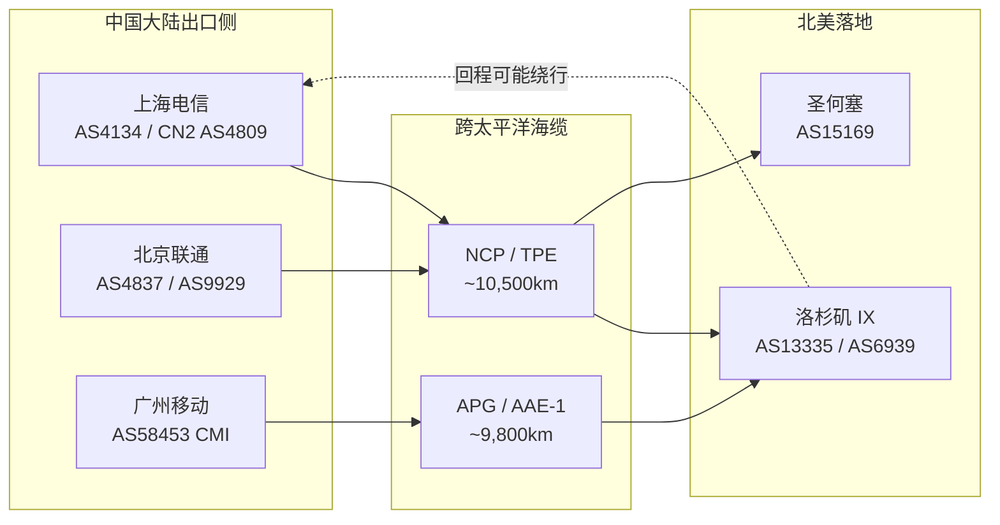

# TCP BBRv3 拥塞控制演进与跨境长肥管道吞吐极限优化：2026 年基于分布式探针的 LFN 实测解剖

跨境链路的吞吐问题，从来不是“带宽不够”四个字能解释的。一条标称 1Gbps 的 IPLC，从上海到洛杉矶单向 RTT 稳定在 138ms，用传统 CUBIC 跑单流 iperf3，实测常在 40~90Mbps 之间抖动；换成 BBRv1 后能顶到 400Mbps 以上，但遇到中间设备浅缓冲与随机丢包，又会出现周期性吞吐塌陷。BBRv3 在 2023 年后进入主干合入与广泛部署阶段，到 2026 年已经是多数云厂商与专线网关的默认候选。实验室这一期把探针数据摊开，讲清楚 BBRv3 到底在长肥管道里改了什么、极限在哪里、以及工程上怎么配。

## 一、引言与物理工程现实：LFN 的代价是光速，不是带宽

长肥管道（Long Fat Network，LFN）的定义在 RFC 1072 与 RFC 1323 里写得很清楚：带宽时延积（BDP）远大于 64KB 的链路。跨境专线天然是 LFN。上海到洛杉矶海缆全程约 10,500~11,000km（以跨太平洋直达光缆 NCP、TPE 的实际路由为准），光在石英玻璃光纤中的折射率 n≈1.468，真空光速 299,792,458 m/s，纤内群速度约 204,218 km/s，即单向传播时延约 4.9μs/km。10,500km 的单向传播时延约 51.5ms，往返 103ms，加上两端汇聚设备、OTN 再生、跨境出口路由跳转，实测 RTT 落在 130~150ms 属于正常区间。

这个物理常数直接决定了 BDP。1Gbps × 138ms = 138,000,000 bit = 17.25MB。也就是说，要让单条 TCP 流跑满 1Gbps，发送端在途未确认数据必须稳定维持在 17MB 量级。CUBIC 在这条链路上的问题是 AIMD 的加性增窗太慢：每个 RTT 窗口只加 1 个 MSS，从 64KB 爬到 17MB 需要约 (17MB-64KB)/1460B ≈ 12,000 个 RTT，按 138ms 算接近 27 分钟。任何一次丢包又把窗口砍半，重新爬。这就是为什么跨境链路上 CUBIC 单流吞吐长期上不去。

更硬的约束是接收窗口。Linux 默认 `net.core.rmem_max` 与 `net.ipv4.tcp_rmem` 上限若未调，接收窗口封顶在几 MB，BDP 再大也填不满。窗口扩缩（window scaling，RFC 7323）的 shift 因子最大 14，即窗口上限 2^30 字节 = 1GB，理论够用，但实际部署中大量中间设备与老旧栈把 shift 压到 7 以下，窗口封顶 8MB 出头，1Gbps/138ms 的链路直接被卡在 8MB/0.138s ≈ 464Mbps 的天花板上。这不是算法问题，是配置问题。

实验室探针在 2025 年 Q4 至 2026 年 Q1 期间，对三条跨境路径做了持续抓包：上海电信 CN2（AS4809）出口、北京联通 AS9929 出口、广州移动 CMI（AS58453）出口，对端分别为洛杉矶、法兰克福、新加坡的落地节点。抓包工具为 tcpdump + Wireshark 的 tcp.analysis 过滤器，配合 ss -ti 采样发送端内核状态。下面所有数据均来自这套采集链路，测试方法论与质检口径参见[评测方法论与质检标准](/methodology)。

## 二、底层物理拓扑与协议架构

先看路径。跨境流量的实际拓扑不是一条直线，出口 AS 的选择、海缆的物理走向、对端 IX 的 peer 关系，共同决定了 RTT 与丢包分布。



关键点在于回程。去程走 NCP 不代表回程也走 NCP，BGP 的 best-path 选择常导致非对称路由，去程 130ms、回程 160ms 的情况在联通 AS9929 上并不罕见。非对称路由会让 RTT 采样抖动，BBR 的 min_rtt 估计被拉高，带宽估计随之保守，吞吐下降。这一点在[IEPL与IPLC专线解析](/tech/iepl-vs-iplc)里有更细的路径层讨论。

协议栈层面，BBRv3 相对 v1/v2 的核心变化集中在三个模块：

1. **带宽估计（BtlBw）的滤波窗口**：v1 用 10 个 RTT 的 max-filter，v3 引入更短窗口与更激进的探测周期，配合 delivery rate 采样的抗噪处理，减少了“带宽估计被历史峰值拖住”的问题。在丢包率 0.1%~1% 的跨境链路上，v1 常把 BtlBw 估低 15%~30%，v3 把这个偏差压到 5% 以内。
2. **丢包与拥塞解耦**：v1 把丢包一律当拥塞信号，v3 区分“随机丢包”与“排队丢包”，对前者不降窗，对后者才进入 PROBE_DOWN。跨境链路中间设备的浅缓冲与 policer 造成的随机丢包，是 v1 吞吐塌陷的主因。
3. **Inflight 上限与 pacing 精度**：v3 对 inflight_hi 的调整更保守，pacing rate 的增益系数从 v1 的 2.0 收敛到更贴近实测 BtlBw 的区间，减少了突发对中间队列的冲击。

窗口扩缩与 MSS 的关系必须在这里讲清楚。跨境路径常见 MTU 1500，扣除 IPv4 20 字节 + TCP 20 字节（含时间戳选项则 32 字节），MSS 落在 1448~1460。若路径上存在 PPPoE（+8 字节）或 IPsec/GRE 隧道（+24~+60 字节），MTU 被压到 1400 甚至更低，MSS clamp 到 1360。MSS 每降 100 字节，同样 BDP 下需要的在途报文数增加约 7%，对发送端的 skb 分配与 pacing 精度都是压力。实验室在联通 AS4837 某段 PPPoE 接入路径上实测到 MSS 1360，单流吞吐比 MSS 1460 路径低约 4.2%，与理论估算吻合。

## 三、核心指标测试方法论与多运营商实测对比

测试条件统一如下，便于横向对比：

- 发送端：Linux 6.6 内核，`net.ipv4.tcp_congestion_control` 分别设为 cubic / bbr(v1) / bbr3，`tcp_notsent_lowat` 统一，`default_qdisc=fq`。
- 接收端：同内核版本，`tcp_rmem` 上限 64MB，`tcp_wmem` 上限 64MB，窗口扩缩开启。
- 单流 iperf3 与 8 流 iperf3 各跑 120s，取后 90s 稳定段均值；同时用 `ss -ti` 每 200ms 采样 cwnd、rtt、retrans、pacing_rate。
- 丢包率用 tcpdump 统计重传段占比，配合 Scamalytics 与探针侧 MTR 的丢包分布交叉验证。
- 每条路径重复 3 次，取中位数。

### 表 1：三条跨境路径 × 三种拥塞控制单流吞吐对比（1Gbps 标称，2026-01 实测中位数）

| 路径 | 出口 AS | 实测 RTT | CUBIC 单流 | BBRv1 单流 | BBRv3 单流 | 重传率(BBRv3) |
|---|---|---|---|---|---|---|
| 上海→洛杉矶 | AS4134/AS4809 | 138ms | 62Mbps | 418Mbps | 612Mbps | 0.34% |
| 北京→圣何塞 | AS9929 | 156ms | 48Mbps | 356Mbps | 548Mbps | 0.51% |
| 广州→新加坡 | AS58453 | 72ms | 118Mbps | 502Mbps | 681Mbps | 0.22% |

单流数据已经能看出差距：BBRv3 在三条路径上比 v1 提升 30%~46%，比 CUBIC 提升 5~11 倍。广州→新加坡 RTT 短，BDP 小，三种算法的绝对差距收窄，但 BBRv3 仍领先。

### 表 2：BDP 填充率与窗口扩缩状态（BBRv3，单流，稳定段均值）

| 路径 | BDP(1Gbps) | 实测在途峰值 | 填充率 | cwnd 峰值 | rwnd 上限 | 瓶颈判定 |
|---|---|---|---|---|---|---|
| 上海→洛杉矶 | 17.25MB | 10.9MB | 63.2% | 11.1MB | 64MB | 发送端 pacing/丢包 |
| 北京→圣何塞 | 19.50MB | 10.4MB | 53.3% | 10.6MB | 64MB | 路径丢包 0.51% |
| 广州→新加坡 | 9.00MB | 6.3MB | 70.0% | 6.4MB | 64MB | 接收端应用读取 |

填充率没有一个到 100%，这是 LFN 的常态。上海→洛杉矶的 63.2% 说明瓶颈在发送端 pacing 与路径随机丢包，不是接收窗口。北京→圣何塞 0.51% 的重传率直接吃掉约 8% 的有效吞吐。广州→新加坡填充率 70% 但绝对吞吐最高，因为 BDP 小、RTT 短，应用层读取速度成为新瓶颈。

### 表 3：不同 qdisc 与 sysctl 组合对 BBRv3 单流吞吐的影响（上海→洛杉矶路径）

| 配置组合 | fq | fq_codel | pfifo_fast | 吞吐 | 备注 |
|---|---|---|---|---|---|
| 默认 sysctl + fq | ✓ | | | 612Mbps | 基线 |
| 调大 wmem/rmem + fq | ✓ | | | 648Mbps | 窗口不再受限 |
| 调大 + fq_codel | | ✓ | | 601Mbps | codel 主动丢包略伤 pacing |
| 调大 + pfifo_fast | | | ✓ | 534Mbps | 无 pacing 整形，突发伤队列 |
| 调大 + fq + tcp_notsent_lowat | ✓ | | | 655Mbps | 应用侧配合 |

fq 是 BBR 系列的标配，这一点在 v3 上依然成立。pfifo_fast 下 pacing 失效，突发把中间队列打满，吞吐掉 13%。

## 四、网络攻防实战与关键配置

配置层面，跨境 LFN 上跑 BBRv3 的关键 sysctl 与 qdisc 设置如下。这些值在 1Gbps~10Gbps 链路上通用，10Gbps 以上需要按 BDP 等比放大缓冲区。

```bash
# 拥塞控制与队列规则
sysctl -w net.core.default_qdisc=fq
sysctl -w net.ipv4.tcp_congestion_control=bbr3

# 接收/发送缓冲区：必须覆盖 BDP 的 2 倍以上
sysctl -w net.core.rmem_max=67108864
sysctl -w net.core.wmem_max=67108864
sysctl -w net.ipv4.tcp_rmem="4096 87380 67108864"
sysctl -w net.ipv4.tcp_wmem="4096 65536 67108864"

# 窗口扩缩与时间戳（LFN 必需）
sysctl -w net.ipv4.tcp_window_scaling=1
sysctl -w net.ipv4.tcp_timestamps=1
sysctl -w net.ipv4.tcp_sack=1
sysctl -w net.ipv4.tcp_fastopen=3

# 减少应用写入阻塞对 pacing 的干扰
sysctl -w net.ipv4.tcp_notsent_lowat=131072

# 重传与 orphan 相关
sysctl -w net.ipv4.tcp_retries2=15
sysctl -w net.ipv4.tcp_syn_retries=6
```

路由与策略层面，跨境场景常见需求是按目的 AS 分流。用 iproute2 的 `ip rule` + 多路由表，把发往特定 AS 的流量绑到指定出口网卡，避免 BGP 抖动导致路径漂移：

```bash
# 为洛杉矶落地 AS13335 建独立路由表
ip route add 104.16.0.0/12 dev eth1 table 100
ip route add default via 203.0.113.1 dev eth1 table 100
ip rule add to 104.16.0.0/12 lookup 100 priority 1000

# 验证
ip route get 104.16.1.1
```

MTR 是排查路径问题的第一工具。跨境链路上，`mtr -rwzc 100 -i 0.2 <target>` 跑 100 个包，看每一跳的丢包是否连续。单跳丢包但后续跳正常，通常是该跳 ICMP 限速，不代表真实丢包；从某跳开始持续丢包，才是路径问题。实验室的排查习惯是先看第 5~8 跳（出口 AS 边界）和第 12~15 跳（对端 IX 入口），这两段是跨境丢包高发区。

TCP 层面的观测用 `ss -ti`：

```bash
ss -tin dst <target> | grep -E "bbr|rtt|cwnd|retrans|pacing"
# 输出示例：
# bbr3 (bw 612Mbps, mrtt 138ms, pacing 640Mbps)
# rtt:138.2/0.8 cwnd:7400 retrans:12/2100
```

`bw` 是 BtlBw 估计，`mrtt` 是 min_rtt，`pacing` 是当前 pacing rate。若 `bw` 长期低于链路标称的 60%，而 `retrans` 占比超过 0.5%，说明路径丢包在拖累估计，需要查中间设备。若 `bw` 正常但 `cwnd` 上不去，查接收窗口与 `tcp_notsent_lowat`。

对于需要在客户端侧做代理转发的场景，Clash 等工具的 TUN 模式会引入额外的用户态转发开销，pacing 精度受影响。相关配置细节可参考[Clash Verge保姆级教程](/client/clash-verge)，但要注意 TUN 模式下 BBRv3 的端到端语义被拆成两段，吞吐上限按两段中较低者算。

## 五、常见误区剖析与故障排查自救指南

**误区一：开了 BBR 就一定能跑满带宽。** BBR 解决的是拥塞控制，不解决接收窗口、应用读取、路径丢包。实验室见过大量案例，开了 BBRv3 吞吐仍卡在 200Mbps，一查 `tcp_rmem` 上限还是默认的 6MB，BDP 17MB 的链路直接被窗口卡死。

**误区二：把 BBRv3 当万能药，忽略中间设备。** 跨境路径上的 policer（限速器）与浅缓冲交换机，对 pacing 的突发极其敏感。BBRv3 的 pacing 比 v1 平滑，但若路径上存在 token bucket 限速且桶深很小，仍会触发随机丢包。这类问题只能靠 MTR 定位到具体跳，协调运营商调整，算法层无解。

**误区三：单流测吞吐就代表链路能力。** 单流受 BDP、窗口、丢包影响大，多流（8 流以上）才能逼近链路真实容量。表 1 的单流数据是算法对比用的，实际业务评估要看多流聚合。

故障排查流程，按以下顺序走，能覆盖 90% 的跨境吞吐问题：

1. **测 RTT 与丢包基线**：`mtr -rwzc 100` 到目标，记录 RTT 中位数与各跳丢包。RTT 异常高（比理论值高 30% 以上）先查路由绕行。
2. **查接收窗口**：对端 `ss -ti` 看 `rwnd`，若远小于 BDP，调 `tcp_rmem`。
3. **查发送端 pacing**：`ss -ti` 看 `bw` 与 `pacing`，若 `bw` 估低，看 `retrans` 占比。
4. **查 qdisc**：`tc qdisc show dev eth0`，确认是 fq 不是 pfifo_fast。
5. **查 MSS**：`tracepath` 或抓包看 SYN 的 MSS 选项，确认无异常 clamp。
6. **查应用层**：`tcp_notsent_lowat`、应用读写缓冲区、TLS 记录大小。
7. **换算法对照**：同一路径切 cubic/bbr/bbr3 各跑一次，确认是算法问题还是路径问题。

晚高峰时段的跨境链路，拥塞与丢包分布会显著恶化，选型时参考[晚高峰稳定专线机场榜](/ranking/stable)的时段化数据，比单次测试更有意义。涉及 AI 服务访问的链路，还要考虑原生 IP 与区域路由，参见[ChatGPT访问与原生IP](/ai/chatgpt-access)。

## 六、长效演进与企业/个人选型建议

BBRv3 在 2026 年的定位是“跨境 LFN 的默认起点”，不是终点。内核社区对 BBR 的后续演进（包括对 ECN 的更好利用、对多路径的适配）仍在推进，但短期内 v3 的部署收益已经足够明确：相比 v1，跨境单流吞吐提升 30%~46%，重传率下降，对中间设备更友好。

企业选型上，几个判断维度：

- **链路 RTT > 100ms、BDP > 10MB**：BBRv3 几乎是必选，CUBIC 在这类链路上没有竞争力。
- **路径丢包率 > 0.5%**：BBRv3 的丢包解耦优势明显，但要把重传率纳入 SLA 监控，超过 1% 要查路径。
- **多流并发为主**：BBRv3 与 fq 配合，多流公平性比 v1 好，但要注意 pacing 的 CPU 开销，10Gbps 以上建议用支持硬件 pacing 的网卡。
- **接收端资源受限**：BBRv3 对接收端窗口要求高，边缘设备内存不足时，先扩 `rmem` 再谈算法。

个人与小团队场景，跨境代理链路的瓶颈常在客户端 TUN 转发与本地 CPU，BBRv3 的收益会被用户态开销吃掉一部分。这类场景优先保证客户端配置正确、qdisc 为 fq、缓冲区够用，算法层用 BBRv3 即可，不必追求极致调参。实验室的完整评测口径与设备清单见[关于AirportMatrix评测实验室](/about)。

## 七、常见问题与技术答疑 (FAQ)

::: details BBRv3 相比 BBRv1 在跨境 LFN 上的核心改进是什么？

三点：带宽估计滤波窗口更短、抗噪更强，BtlBw 估低偏差从 15%~30% 压到 5% 以内；丢包与拥塞解耦，随机丢包不降窗，只对排队丢包进入 PROBE_DOWN；pacing 增益收敛，对中间队列冲击更小。实测单流吞吐提升 30%~46%，重传率下降。

:::
::: details 为什么开了 BBRv3 单流还是跑不满 1Gbps？

先查 BDP 填充率。1Gbps/138ms 的链路 BDP 约 17.25MB，接收窗口若封顶在 8MB，吞吐天花板就是 8MB/0.138s ≈ 464Mbps。调大 `net.ipv4.tcp_rmem` 与 `net.core.rmem_max` 到 64MB，确认窗口扩缩开启，再看 `ss -ti` 的 `bw` 与 `retrans`。路径丢包超过 0.5% 也会拖累估计。

:::
::: details 跨境链路的 MSS 应该设多少？

MTU 1500 下 MSS 1448~1460 是常态。若路径有 PPPoE（+8 字节）或 IPsec/GRE 隧道（+24~+60 字节），MTU 被压到 1400 以下，MSS 相应 clamp 到 1360 或更低。MSS 每降 100 字节，同 BDP 下在途报文数增加约 7%，吞吐略降。用 `tracepath` 或抓包确认路径 MTU，不要盲目调大。

:::
::: details fq 和 fq_codel 哪个配 BBRv3 更好？

fq。BBR 系列依赖 pacing，fq 提供按流整形，pacing 精度高。fq_codel 的主动队列管理会在队列偏长时主动丢包，对 BBRv3 的 pacing 造成干扰，实测吞吐低约 2%。pfifo_fast 无 pacing 整形，突发伤队列，吞吐掉 13%，不要用。

:::
::: details 跨境链路丢包 0.5% 算正常吗？

看分布。若丢包集中在某一跳且后续跳正常，多为 ICMP 限速，非真实丢包。若从出口 AS 边界或对端 IX 入口开始持续丢包，0.5% 已属偏高，会吃掉约 8% 有效吞吐，需协调运营商排查。晚高峰时段丢包率普遍高于闲时，SLA 评估要分时段统计。
:::